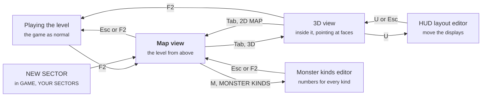

# NEON-CASTER Level Editor Guide

A sector takes five minutes to start: **GAME > YOUR SECTORS > NEW SECTOR**, then carve rooms, put things in them and save. You can build from above on the map, or from inside, pointing at walls and floors with the mouse. Everything below is checked against `neon-caster.bas`.

- [Your first sector](#your-first-sector)
- [How the editor fits together](#how-the-editor-fits-together)
- [The toolbar and the picker](#the-toolbar-and-the-picker)
- [The 3D view](#the-3d-view)
- [Shaping: the wheel, the arrows, Delete](#shaping-the-wheel-the-arrows-delete)
- [Pictures on faces, and Divide](#pictures-on-faces-and-divide)
- [The properties pane](#the-properties-pane)
- [The map view](#the-map-view)
- [Every map character](#every-map-character)
- [Heights](#heights)
- [Lights](#lights)
- [Beyond the editor: the level file](#beyond-the-editor-the-level-file)
- [Building from the console](#building-from-the-console)
- [The monster and HUD editors](#the-monster-and-hud-editors)
- [Gotchas, and a checklist before you save](#gotchas-and-a-checklist-before-you-save)

## Your first sector

A playable sector needs only four things: walls all round the edge, one start, one exit, and a way to walk from the start to the exit. NEW SECTOR gives you all four. Everything else is decoration.

1. Open **GAME > YOUR SECTORS > NEW SECTOR**. You get sector 11 (then 12, up to 20), saved as `neon-caster/levels/custom/custom1.txt`. It's solid wall with one lit 8 × 8 room in the middle, cells 20 to 27 each way. You stand at (21, 24) facing east, and the exit `E` is at (28, 24).
2. You land in the **map view**: the level from above. Press **Tab** (or the **3D** button) to be inside it instead. Either way, the **toolbar** has the tools and the **picker** has everything you can put in a level.
3. **Push a wall back.** In the 3D view, point at a wall and hold **Shift** while you turn the wheel down: the wall goes back a cell at a time and the room grows. Wheel up with Shift pulls a wall out towards you.
4. **Carve a room from above.** In the map view, choose **PLACE**, open the picker's **SPECIAL** tab and click the floor tile, then hold **Shift** and drag a box. The whole box becomes floor. Make sure it touches the first room.
5. **Add a door.** Picker, **DOORS** tab, click the sliding door, then click the wall cell between the rooms. Doors need a wall either side to slide into.
6. **Put things in it.** The **MONSTERS** and **ITEMS** tabs. In the 3D view a see-through copy shows where each one will go before you click.
7. **Light it.** The **LIGHTS** tab: click an effect and a colour, then click a wall or a floor.
8. **Save** with **SAVE** or **Ctrl+S**. The message warns you if there's no start, no exit, or a gap in the border, but it saves either way.
9. **Play it.** **F2** leaves the editor and the sector plays as a real level. To come back later, it's in **GAME > YOUR SECTORS**.

To rename it, open the console (`` ` ``), type `sectorname MY FIRST MAP`, then `savelevel`.

**Three examples to take apart.** YOUR SECTORS starts with three sectors built to show the editor off (so your first NEW SECTOR is number 14): **11, THE GALLERY** (pictures on single faces, a checkerboard floor laid cell by cell, two-tone pillars, paintings lit and tinted by lights on their faces, statues that wake only when shot and guards that hear it), **12, THE SUNKEN DEPOT** (a walkway a wall up, a shaft with no bottom and a causeway across it, beams hanging from the dark, firelight on the furnace wall, crawler closets, a stalker hunting you from the start) and **13, THE RELAY** (chambers only teleporters reach, each pad LINKed to its own, each chamber in pictures of its own). Open one with F2 and click about: the panes show how each thing is set up. They're made by `neon-caster/levels/showcase.py`, which writes them again from scratch, so don't run it once you've changed them.

Undo is **UNDO** or **Ctrl+Z**, up to 40 steps. One drag, or one run of wheel turns, counts as one step. **F1** (or **HELP**) shows every key for the view you're in.

## How the editor fits together



Both views edit the same level and share one **selection**, one **tool** and one **brush**, so you can select from above and shape from inside. Esc in the 3D view opens the pause menu instead of leaving.

The world is a grid of cells, 48 × 48. Walls fill whole cells, and each cell has one floor height and one ceiling height. So walls move a whole cell at a time, heights move an eighth of a wall at a time, and **Divide** (below) splits a face's *picture* in two, not the wall itself.

## The toolbar and the picker

**The toolbar** runs along the top of the 3D view, and down the panel on the right of the map view. Point at a button for a line saying what it does.

| Button | Does |
| --- | --- |
| SELECT | A click selects (the default tool) |
| PLACE | A click puts the brush there: a wall, a door, a thing |
| PAINT | A click gives a face the brush's picture |
| LIGHT | A click puts a light on a face |
| HEIGHT | A click raises a floor or ceiling an eighth; Shift+click lowers it |
| DELETE | Deletes the selection (also **Del**) |
| UNDO, SAVE | Ctrl+Z, Ctrl+S |
| GRID, and the slider | Lines on every cell's edge, drawn into the world, and how strong they are (also **G**, and **Shift+G**) |
| PICKER | 3D only: the picker tucked away (it opens when the pointer reaches the bottom of the screen), always open, or off (also **P**) |
| 2D MAP / 3D | The other view (also **Tab**) |
| HELP | Every key for this view (also **F1**); click anywhere to close it |
| < SECT, SECT > | Map view only: the sector before or after (PgUp, PgDn). Refused while there are unsaved changes. |
| MONSTER KINDS | Map view only: the monster kinds editor (M) |

**The picker** is everything you can put in a level, as pictures: along the bottom in the 3D view (two rows of eight), and under the title in the map view (three rows of four). The wheel over it, or the arrows beside it, scroll it.

| Tab | Has |
| --- | --- |
| WALLS | The six wall types `#` `N` `C` `K` `P` `G` in their pictures, the diagonals, the secret wall, glass; then every wall picture there is |
| FLOORS, CEILINGS | Every floor and ceiling picture |
| DOORS | Sliding, shutter, split, the three key doors, the sealed door, the exit |
| ITEMS | Keycards, health, armour, ammo, guns, the map, overcharge, the amp |
| MONSTERS | All nine |
| DECOR | All 21 decorations |
| SPECIAL | The start (four ways round), the teleporter pad, the data station, the code terminal, plain floor |
| LIGHTS | The six ways a light can go (steady, flicker, pulse, strobe, fire, dying), each shown going, in the brush's colour; then twelve colours |

Click one and it's the **brush**, and the tool that uses it is chosen for you: a map character picks PLACE, a picture picks PAINT, an effect or colour picks LIGHT. If something is **selected** when you click, it's done to the selection at once: the character is put in every selected cell (for a wall face, the cell in front of it), the picture painted on every selected face, the effect or colour given to every selected face's light.

## The 3D view

The game, frozen, with a mouse pointer. Monsters don't move, pickups aren't taken, events and triggers don't run, nothing hurts you, the gun is put away and you fly.

| Input | Does |
| --- | --- |
| Mouse | Points. Whatever's under the pointer is outlined in pulsing cyan and named: a WALL, FLOOR, CEILING, STEP (the face of a floor stepping up) or LINTEL (the face of a ceiling stepping down), its cell and side - or a monster, pickup or decoration by name |
| Right button (hold) | Look round instead; the crosshair picks while you do |
| Your walk keys | Fly, straight through walls |
| Space, C | Up, down (Shift: faster) |
| Left click | The tool (below) |
| Wheel | Shape what's selected, or what's under the pointer (next section) |
| Ctrl+D | Select nothing |
| Del | Delete the selection |
| H, V | Divide a face left / right, top / bottom |
| G, Shift+G | The grid, and how strong it is |
| P | The picker: tucked away, always open, off |
| F1 | Help |
| Tab | The map view |
| F2 | Leave the editor and play |

**The tools, in 3D:**

| Tool | Click | With Shift | With Ctrl | With Alt |
| --- | --- | --- | --- | --- |
| SELECT | Select the face (or thing) | Add it to the selection, or take it out | The whole floor or ceiling it's part of: every cell joined to it at the same height | |
| PLACE | Put the brush in the cell: a floor's own cell, a wall's the cell in front. Hold the button and sweep to place along the floor. | Take away the thing there | | Pick it up as the brush |
| PAINT | The brush's picture on the face (on the half, if it's divided) | The usual picture again | The whole floor or ceiling | Pick its picture up as the brush |
| LIGHT | A light on the face, as the light brush is. A face that has one is selected instead, for its pane. | Take the face's light away | | |
| HEIGHT | Raise the floor or ceiling an eighth | Lower it | | |

In PLACE, a magenta box on the floor and a see-through copy of the brush show where it will go before you click. Monsters, pickups and decorations can be clicked: they select their cell.

The older keys still work, aimed along the middle of the view: **T** steps every wall of the aimed letter through the wall pictures (Shift: back), **F** the front cell's floor picture, **Z** gives the front cell the next of the level's four floors, **L** a light over the front cell and **K** takes away the light nearest you, **PgUp**/**PgDn** the front cell's floor (Shift: its ceiling), **E** picks up the aimed cell's character, `[` `]` step the brush, **1**-**8** a light preset, **U** the HUD layout editor.

**Every change rebuilds the level.** Killed monsters come back, pickups reappear, doors shut, and your keycards and map are taken away. You stay where you are.

## Shaping: the wheel, the arrows, Delete

**The wheel** works on the selection; with nothing selected, on the face under the pointer, which then stays selected so you can keep turning. A pause of half a second starts a new undo step.

| On | Wheel up / down |
| --- | --- |
| A floor, a step's face | Its floor up / down an eighth (Ctrl: a whole wall) |
| A ceiling, a lintel's face | Its ceiling up / down an eighth (Ctrl: a whole wall) |
| A wall, with Shift | Pull the wall out towards you a cell / push it back. Pushing opens the cell and gives it the floor and ceiling of the cell in front. |
| A wall, with Alt | Push it back / pull it out |
| A wall, with Ctrl+Shift | Make it a block standing on the floor; keep turning to set its top |
| A wall, with Alt+Shift | Make it a block hanging from the ceiling; keep turning to set its bottom |

Rough a level out this way: Shift+wheel walls back to make rooms and corridors, wheel floors down for pits and up for platforms, Ctrl+Shift for a counter or a crate-sized block, Alt+Shift for a low beam to duck under.

**The arrows** move the selection's cells a cell: in 3D, away from you, back, left and right as you face (whichever way along the grid is nearest); on the map, up the screen is north. Everything in a cell goes with it: what's there, its floor and ceiling, a monster's own settings. A cell left behind becomes like the cell behind it, so a platform slides along leaving floor like the floor round it. Nothing moves into the border, and a start is never copied.

**Delete** (Del, or DELETE): a selected wall is opened up (its floor and ceiling like the cell in front), a thing on a selected floor is taken away (never the start), and a selected step or lintel is flattened to the floor or ceiling in front of it.

## Pictures on faces, and Divide

Any face can have a picture of its own: a wall's side, a step's or lintel's face, a floor, a ceiling. Pick a picture in the picker (it chooses PAINT) and click faces. **Ctrl+click** paints a whole floor or ceiling, **Shift+click** puts back the usual picture, **Alt+click** picks a face's picture up. Picking a picture with faces selected paints them all. From above, PAINT paints a cell's floor (Ctrl: its ceiling), or all four sides of a wall.

**Divide** splits a face in two for pictures. Point at a face (or select some) and press **H** for left | right or **V** for top | bottom; press it again to make the face whole. The halves start with the face's picture. Each half is outlined on its own when you point at it ("half 1", "half 2"), can be selected on its own, and painted on its own. A floor or ceiling divides west | east (H) or north | south (V). Top | bottom splits at the face's middle height, so on a tall wall it may be above your eye.

Both renderers draw every picture and half. A sector can use up to **24** pictures of its own on faces, counting the tinted copies lights make (below); past that, extra ones are ignored without a message.

## The properties pane

Select something and its pane opens: on the right in the 3D view, over the map's right side in the map view. Changes apply to everything selected of that kind.

| Selected | The pane |
| --- | --- |
| A door | Its kind: SLIDING, SHUTTER, SPLIT, SEALED, RED KEY, BLUE KEY, YELLOW KEY, EXIT |
| A teleporter pad | Where it goes. **LINK...** and then click another pad to pair the two (saved as `[pads]`); **UNLINK** returns it to pairing in reading order. In 3D every pair is joined by a purple line. |
| A face with a light | Its colour (twelve), effect (six), REACH and BRIGHT, REMOVE THE LIGHT. The swatch in the corner shows it going. |
| A monster | SIGHT, HEARING, HEALTH and SPEED, and what WAKES it; AS ITS KIND IS resets it. Its sight (cyan) and hearing (yellow) are drawn as rings on the floor round it. |
| A floor of a lift | LOW, HIGH and SPEED in eighths, UP AND DOWN or ELEVATOR, REMOVE |
| Floor | MAKE A LIFT OF IT (the selected cells' box, from their floor up a wall), and ADD A LIGHT TO IT |
| Any other face | ADD A LIGHT TO IT |

**Monsters, for ambushes.** Each monster can be set apart from its kind:

| Setting | Means | As its kind |
| --- | --- | --- |
| SIGHT | How far away it notices you, in cells | 14 |
| HEARING | How far away your shots wake it, in cells; 0 is deaf | deaf |
| HEALTH, SPEED | Against its kind's, in % | 100% |
| WAKES WHEN: IT SEES YOU | Seeing you within its sight | yes |
| YOU'RE NEAR | You coming within its sight, seen or not: round a corner, behind a door | |
| IT'S HIT | Only being hit; nothing else wakes it | |
| HUNTING | Nothing: it's hunting you from the start | |

A closet of YOU'RE NEAR crawlers with a sight of 2 springs as you pass; a heavy with HEARING 12 comes running at the first shot. The settings are kept by the cell the monster starts in, so moving it with the arrows takes them along, but deleting it and placing a new one doesn't.

## The map view

The whole 48 × 48 map from above, one square per cell, with the picker, the toolbar and the help line in the panel on the right.

| Tool | Left button | Right button | Shift |
| --- | --- | --- | --- |
| SELECT | Select the cell; drag a box to select it all | | Add to the selection (Shift+click one cell: in or out) |
| PLACE | Put the brush in the cell; drag to keep going | Pick up what's in the cell as the brush | Drag a box: fill it when you let go |
| PAINT | The picture on the cell's floor, or a wall's four sides; drag on across cells (Ctrl: the ceiling) | | The usual picture again |
| LIGHT | A light in the middle of the cell, as the light brush is | Take away the nearest light within 1.5 cells | |
| HEIGHT | Raise the floor an eighth | Lower it | The ceiling instead |

| Input | Does |
| --- | --- |
| Wheel | Over the picker: scroll it. Over the map, with something selected: the selected floors up / down an eighth (Ctrl: ceilings). Otherwise the brush, back and forth. |
| `[` `]` | The brush, back and forth |
| Arrows | Move the selection a cell (up the screen is north) |
| Del, Ctrl+D | Delete the selection, select nothing |
| L, H | The LIGHT tool, the HEIGHT tool (again: back to PLACE) |
| 1–8 | A light preset (below) |
| G, Shift+G | The grid lines, and how strong |
| T | Move yourself to the cell under the mouse. It doesn't check for walls. |
| PgUp / PgDn | Previous / next sector |
| M | The monster kinds editor |
| U | The HUD layout editor |
| Tab | The 3D view |
| Esc, F2 | Leave the editor and play |
| F1 | Help |

You can't change the outer ring of cells (x or y of 0 or 47), so the border always stays wall. Placing a new start (`<` `>` `^` `v`) turns the old one into floor, so there's never more than one.

**Light presets** (the keys 1–8) are room lights, radius 5 and brightness 140:

| Key | Preset | Colour | Effect |
| --- | --- | --- | --- |
| 1 | white | 230, 235, 255 | steady |
| 2 | cyan | 60, 220, 255 | steady |
| 3 | magenta | 255, 60, 220 | steady |
| 4 | orange | 255, 160, 60 | steady |
| 5 | green | 90, 255, 120 | steady |
| 6 | red alarm | 255, 40, 40 | strobe |
| 7 | flickering | 220, 230, 255 | flicker |
| 8 | firelight | 255, 150, 70 | fire |

**What the map shows.** Walls are drawn in their picture's average colour and floor is dark blue. Pickups are green squares, monsters red, decorations gold, and you're a yellow circle with a line showing which way you face. Lights are a ring in their colour; with the LIGHT tool their full reach is drawn too. Event rooms have a magenta outline and triggers an orange one. With the HEIGHT tool, raised floors are shaded brown (brighter is higher), sunken floors purple, an unusual ceiling gets two cyan dots, and lifts get a green outline. The selection is outlined in orange.

The line under the map names the cell under the mouse, as `x,y name`, with its floor and ceiling if they're not the usual. x counts 0–47 left to right and y counts 0–47 top to bottom.

## Every map character

Each cell of the map is one character, and case matters: `m` is a drone, `M` is the map pickup. Any character not listed here is plain floor. In the file, in this order (the picker shows them as pictures, by tab):

```
. # N C K P G /
\ D H X R B Y E
! = @ $ % & r b
y + * u a e 2 3
4 M q j m g h c
s k w z T o i p
t x l n f S d A
F I J L O Q U W
Z V < > ^ v
```

**Walls and structure**

| Char | What | Notes |
| --- | --- | --- |
| `.` | Floor | |
| `#` `N` `C` `K` `P` `G` | Solid walls | They differ only in looks: pictures 1–6 of the level's `walls =` list, in that order. `#`'s picture is also used for the steps between floor heights. |
| `/` `\` | Diagonal walls | Half wall, half floor, corner to corner. The solid half is chosen from the walls next to it, and it takes their look. You can't walk through one. |
| `%` | Secret wall | Looks like the walls around it. Slides away when a closet event (kind 6) within 3 cells goes off. |
| `=` | Glass | A see-through pane. Put it in a straight wall one cell thick. 4 hits break it. |
| `@` | Data station | A wall you jack into with Space. Hacking it opens nearby `!` doors. |
| `$` | Code terminal | A wall with a QB64 puzzle: the next name from `puzzles =`, in reading order. |
| `&` | Teleporter | Pads pair up in reading order: 1st with 2nd, 3rd with 4th. Up to 16. |

**Doors.** A door must sit between two walls.

| Char | What | Opens |
| --- | --- | --- |
| `D` | Sliding door | Space; stays open 4 s |
| `H` | Shutter, rolls up | Space; slower, open 6 s |
| `X` | Split door | Space; fastest, open 3 s |
| `R` `B` `Y` | Key door | Needs the red, blue or yellow keycard |
| `!` | Sealed door | Opens when the nearest data station `@` is hacked |
| `E` | **The exit** | Never opens; Space on it ends the level. Gets a green pulsing light. |

**Pickups.** Up to 64 per level.

| Char | Pickup | | Char | Pickup |
| --- | --- | --- | --- | --- |
| `r` `b` `y` | Red / blue / yellow keycard | | `u` | Armour +50 |
| `+` | Health +25 (up to 100) | | `*` | Big medkit +50 |
| `a` | Energy cells +15 | | `4` | Railgun, +30 cells |
| `e` | Shells +8 | | `M` | The map |
| `2` | Scatter gun, +8 shells | | `q` | Overcharge +100, up to 200 |
| `3` | Repeater, +30 cells | | `j` | Damage amp: double damage for 30 s |

**Monsters.** Up to 64 per level, counting ones events spawn.

| Char | Monster | Hits to kill |
| --- | --- | --- |
| `m` | drone | 3 |
| `g` | gunner | 4 |
| `h` | heavy | 10 |
| `c` | crawler | 2 |
| `s` | sentry | 8 |
| `k` | stalker | 3 |
| `w` | spitter | 6 |
| `z` | overseer (boss) | 80 |
| `T` | thief | 5 |

**Decorations.** Up to 64 per level. They block your way, and most can be shot to pieces.

| Char | Thing | | Char | Thing |
| --- | --- | --- | --- | --- |
| `o` | Barrel (explodes) | | `A` | Control console (glows) |
| `i` | Lamp (cyan light) | | `F` | Wall of screens (glows) |
| `p` | Plant | | `I` | Specimen tank (glows) |
| `t` | Terminal (green pulse) | | `J` | Lab bench |
| `x` | Crate | | `L` | Generator (fire glow) |
| `l` | Server rack (blinks) | | `O` | Cryo pod (glows) |
| `n` | Vending machine (pink) | | `Q` | Hologram (glows) |
| `f` | Coolant tank (explodes) | | `U` | Lockers |
| `S` | Spawner (the portal nest events use) | | `W` | Bench |
| `d` | Desk | | `Z` | Chair |
| | | | `V` | Body (doesn't block, can't break) |

**The start.** `<` `>` `^` `v` put you there, facing left, right, up or down the map. Keep exactly one.

## Heights

Every cell has its own floor and ceiling height, measured in **eighths of a wall**. The usual floor is 0 and the usual ceiling is 8 (one wall up). You can step up 2 eighths, but 3 eighths blocks you, so make stairs from 2-eighth steps.

**Raising and lowering**

- **3D view:** point at a floor or ceiling (or select some) and turn the **wheel**; Ctrl moves a whole wall at a time. Or the HEIGHT tool: click to raise, Shift+click to lower.
- **Map view:** select cells and turn the wheel (Ctrl: ceilings); or the HEIGHT tool: click to raise a cell's floor, right-click to lower it, Shift for the ceiling.
- **Console:** `raise X Y EIGHTHS` for one cell, or `raise X0 Y0 X1 Y1 EIGHTHS` for a box; add `ceil` for the ceiling.

| Rule | Value |
| --- | --- |
| Highest step you can walk up | 2 eighths (the limit is 0.32 of a wall) |
| Lowest gap you can walk under | 6 eighths of room between floor and ceiling |
| A floor can't go above | its ceiling minus 2 eighths |
| A floor can't go below | −8, a bottomless pit: fall in and you die |
| A drop that hurts | about 8 eighths (a whole wall); 7 doesn't |

With the usual ceiling, a floor tops out at 6 eighths. Raise the ceiling first to build higher. When the editor refuses a change, it says nothing, so if a click seems to do nothing, check the ceiling.

**In the level file**, heights are two extra maps, `[floor]` and `[ceiling]`, one character a cell:

| Char | Means |
| --- | --- |
| `.` | The usual: floor 0, ceiling 8 |
| `0`–`9`, `a`–`z` | 0 to 35 eighths up: `8` is one wall, `g` is two, `z` is 4⅜ |
| `A`–`H` | 1 to 8 eighths down; `H` is a pit |

Case matters here too: `a` is 10 up, `A` is 1 down. A level with neither section is flat and draws the fast classic way.

**Floor hazards** come from the floor picture's name: a floor whose picture name contains `molten` or `lava` burns you, and `murky` or `slime` slows you down.

## Lights

A level is lit by one **ambient** level everywhere, plus up to 96 **lights** that stop at walls.

**Lights on faces.** With the LIGHT tool, a click puts a light just in front of the middle of the face you click, in the light brush's colour and effect. The **LIGHTS** tab sets the brush (each effect is shown going, as it will in the game), and a face's pane sets its light's colour, effect, reach (in cells) and brightness, or removes it. A light on a wall's face also **tints the face itself** its colour: a coloured copy of its picture, which OpenGL lights by itself and pulses or flickers with the light. So a red light shows red on its wall even in a room already as bright as it can be, where light alone would add nothing. A light on a floor or ceiling, or in the middle of a cell, lights the room round it the usual way. Each light is a little star in its colour in the 3D view.

Lights add to what's there, and the brightest a pixel can be is its picture's own colours. So in a brightly lit room a coloured light shows mostly on the face it's on. For moody colour, lower the ambient.

**`ambient = brightness, red, green, blue`** sets the base light. Brightness runs 0–256, where 256 shows every picture in its own colours; the other three tint it (0–255). NEW SECTOR uses `165, 225, 220, 255`, a cool dim blue.

**`[lights]`** has one line per light: `x, y, radius, brightness, red, green, blue, effect`.

| Field | Meaning |
| --- | --- |
| `x`, `y` | Where, in cells. `20.5` is the middle of cell 20. A light on a wall's face sits 0.12 in front of it (`26.12`, `19.88`...), and that's how the game knows to tint the face. |
| `radius` | How far it reaches, in cells. It fades to nothing at the edge. |
| `brightness` | 0–400, added on top of the ambient light |
| `red`, `green`, `blue` | Its colour, 0–255 each |
| `effect` | 0 steady · 1 flickering tube · 2 slow pulse · 3 alarm strobe · 4 firelight · 5 dying tube |

**The 96-light budget includes automatic lights.** Lamps, terminals, server racks, glowing decorations, the exit and teleporter pads each add a light of their own. Past 96, extra lights are dropped without a message, and the editor can't warn you because it only counts the level's own list. If a light you placed doesn't show, you've probably hit the limit.

The console can switch a light while you play: `light N on` or `light N off`, where N counts the `[lights]` lines from 1. A trigger can do the same.

## Beyond the editor: the level file

Some things have no editor tool yet: events, triggers, the name, the ambient light and the puzzles. Write them into the level file, `neon-caster/levels/custom/customN.txt`, in any text editor, then reload the sector. The file is plain text: `key = value` lines at the top, then `[sections]`, and lines starting with `'` are comments.

Ctrl+S rewrites the whole file in a fixed layout. Only the comments at the very top survive, so keep your notes there.

**Pictures.** `walls =` needs exactly 6 picture names (for `# N C K P G`), `floors =` 4 and `ceilings =` 2. A misspelled name makes the game quit with "Missing texture". These are the pictures in `neon-caster/`:

- **Walls:** wall, wall2, wall-adverts, wall-biolab, wall-brick, wall-coils, wall-concrete, wall-control, wall-core, wall-cryo, wall-datastream, wall-frost, wall-furnace, wall-girders, wall-graffiti, wall-grate, wall-greenhouse, wall-greenpipes, wall-hazard, wall-hull, wall-ice, wall-moss, wall-obsidian, wall-pipes, wall-reactor, wall-rusty, wall-servers, wall-slime, wall-stripes, wall-terminals, wall-tiles, wall-transit, wall-vault, wall-viewport, wall-vines, wall-white. (`wall-jack` and `wall-code` are the data station's and code terminal's own.)
- **Floors:** floor, floor-circuit, floor-cobbles, floor-concrete, floor-core, floor-deck, floor-frostgrate, floor-glow, floor-hazard, floor-ice, floor-lab, floor-molten (burns), floor-murky (slows), floor-plates, floor-platform, floor-rustgrate, floor-scorched, floor-soil, floor-white.
- **Ceilings:** ceiling, ceiling-cables, ceiling-core, ceiling-frost, ceiling-girders, ceiling-growlights, ceiling-hull, ceiling-lights, ceiling-pipes, ceiling-stone, ceiling-tunnel, ceiling-vents, ceiling-warning.

All end in `.png`. The picker's WALLS, FLOORS and CEILINGS tabs show them all, and PAINT puts any of them on any face (`[faces]`, below) without changing the lists.

**`[zones]`** choose which of the 4 floor and 2 ceiling pictures each area uses: `x0, y0, x1, y1, floor, ceiling, shape`. `floor` is 1–4 and `ceiling` 1–2 (0 leaves it alone). `shape` 0 is the whole rectangle; 1–4 is the top-left, top-right, bottom-right or bottom-left triangle of a square. Later zones win where they overlap. The 3D view's **Z** adds a one-cell zone. Up to 64.

**`puzzles = NAME, NAME, …`** gives each `$` code terminal its puzzle, in reading order, from `neon-caster/puzzles/`: countdown, function, hello, multiply, password, pythagoras, reverse, select, sum, wrap.

**`[events]`** are rooms that do something when you walk in: `kind, x0, y0, x1, y1, a, b, reward`. Doors within 5 cells of the room belong to it. Up to 16.

| Kind | Event | `a` | `b` |
| --- | --- | --- | --- |
| 1 | Ambush | How many monsters | Monster type (0 = a mix) |
| 2 | Survive | Seconds | Frames between arrivals |
| 3 | Trap (electric) | Frames live | Frames safe |
| 4 | Gallery | Seconds to break every decoration in the room | |
| 5 | Nest | Monster type | Frames between spawns |
| 6 | Closet | | (opens `%` walls within 3 cells) |
| 7 | Hoard | | (sealed until every thief is dead) |
| 8 | Plate | Frames until the blast | Frames until it re-arms |
| 9 | Laser | Frames on | Frames off (0 = always on) |
| 10 | Cutter | Frames per sweep | |
| 11 | Blackout | Seconds | Number of monsters |
| 12 | Trap (fire) | Frames live | Frames safe |

A trap's floor gets its own picture (a glowing wire grid, or a burner grate), and it warns you for half a second before it goes live: crackles and short arcs, or smoke and embers. While live it arcs or blazes, lights the room and buzzes or roars. Use kind 12 in hot places (reactors, foundries), kind 3 elsewhere.

Monster types are numbered in the order of the monster table: 1 drone to 9 thief. `reward` is a pickup given when you win, numbered in this order: 1 red card, 2 blue card, 3 yellow card, 4 health, 5 cells, 6 shells, 7 scatter gun, 8 repeater, 9 armour, 10 medkit, 11 railgun, 12 map, 13 overcharge, 14 amp. Use 0 for none. Only ambush, survive, trap and gallery give one. A trap or cutter with `a` of 0 is a mistake: it logs an error.

**`[lifts]`** (MAKE A LIFT, and a lift's pane): `x0, y0, x1, y1, low, high, mode, speed`. `low` and `high` are in eighths and `speed` is eighths a second. `mode` 1 goes up and down by itself, 2 is an elevator (up when you step on, down after you step off), and 3 moves only when a `liftgo` command says so. Up to 16.

**`[faces]`** (PAINT and Divide): a picture of its own on one face, one line each: `x, y, face, divided, picture, second picture`. `face` is `E` `S` `W` `N` for a side of the cell (a wall's, or a step's face), `LE` `LS` `LW` `LN` for a lintel's, `F` the floor, `C` the ceiling. `divided` is 0 for the whole face, 1 for left | right, 2 for top | bottom; the second picture is the second half's (left out: the usual picture). Up to 4000.

```
26, 26, W, 0, wall-adverts.png
25, 18, S, 2, wall-adverts.png, wall-brick.png
24, 23, F, 1, floor-circuit.png, floor-cobbles.png
```

**`[pads]`** (LINK): teleporter pads paired by hand, `x1, y1, x2, y2`. Pads in no pair here pair up as ever, in reading order. Up to 16.

**`[monsters]`** (a monster's pane): `x, y, sight, hearing, health, speed, wake`, by the cell the monster starts in. Sight and hearing are in cells, health and speed in % of its kind's, and wake is 0 seeing you, 1 you near, 2 being hit, 3 hunting from the start.

**`[triggers]`** run console commands when something happens: `WHEN [repeat] : COMMAND ; COMMAND`.

| WHEN | Fires when |
| --- | --- |
| `enter X0 Y0 X1 Y1` | You step into the rectangle |
| `use X Y` | You press Space facing that cell |
| `clear X0 Y0 X1 Y1` | Every monster that started in the rectangle is dead |
| `time S` | S seconds into the level |

Without `repeat`, a trigger fires once. Don't put `repeat` on `time` or `clear`: once true they stay true, so the trigger fires every frame. If you start inside an `enter` rectangle, it waits until you leave and come back. Up to 48. For example:

```
enter 20 20 22 22 : message AMBUSH! ; summon stalker 3
use 30 14 : door 31 14 open ; sound alarm
```

## Building from the console

The console (`` ` ``, in the game or the 3D view) can build with exact coordinates, which is quicker than clicking for big shapes. Put several commands on one line with `;`, and press Tab to finish a command's name. The building commands work even outside the editor, but each one rebuilds the level, so monsters and pickups reset.

| Command | Does | Kept by Ctrl+S? |
| --- | --- | --- |
| `edit` / `edit walk` / `edit off` | Open the editor at the map or 3D view, or close it | |
| `put X Y CHAR` | Put one character in a cell | Yes |
| `box X0 Y0 X1 Y1 CHAR` | Fill a rectangle (one undo step) | Yes |
| `raise X Y EIGHTHS [ceil]` | Raise (or lower, with a minus) one cell's floor or ceiling | Yes |
| `raise X0 Y0 X1 Y1 EIGHTHS [ceil]` | The same for a rectangle | Yes |
| `lamp X Y [1-8]` | A light over a cell, in a preset | Yes |
| `lift X0 Y0 X1 Y1 LOW HIGH [MODE] [SPEED]` | Add a lift (mode 2 and speed 8 unless you say) | Yes |
| `trigger WHEN : CMD \| CMD` | Add a trigger; `\|` separates its commands. `trigger del N` removes one. | Yes, but Ctrl+Z can't remove it |
| `triggers` | List the level's triggers | |
| `undo` / `savelevel` | Same as Ctrl+Z / Ctrl+S | |
| `newsector` | A new blank sector of your own, in the editor | |
| `sectorname NAME` | Rename the sector you're in | After `savelevel` |
| `map 11` / `maps` | Go to a sector by number (or part of its name) / list them all | |

These only change the running level, so they're for testing and for triggers rather than building:

| Command | Does |
| --- | --- |
| `door X Y open\|close\|lock\|unlock\|toggle` | Work a door |
| `wall X Y CHAR` | Swap a wall (`#` `.` `N` `C` `K` `P` `G`) until the next rebuild |
| `light N on\|off` | Switch one of the level's lights |
| `liftgo N up\|down` | Send a lift |
| `message TEXT` | Show a message |
| `sound NAME` | Play `sfx/NAME.wav` |

`help` doesn't list most of these yet, but Tab completes them all. Two worth knowing for testing: `summon TYPE [N]` puts monsters in front of you, and `god` stops them hurting you.

A room by console, as an example (sector made with NEW SECTOR):

```
box 29 21 36 27 . ; put 28 24 D ; put 37 24 E ; lamp 32 24 2 ; savelevel
```

That carves a second room east of the first (both corners are included), turns the old exit at (28, 24) into a door between the rooms, puts the exit in the new room's east wall, and lights the room cyan. There's still exactly one exit.

## The monster and HUD editors

Both change files that every sector shares, not the sector you're in.

**Monster kinds editor** (**M** or MONSTER KINDS in the map view, or `monsters` in the console) sets the numbers for each kind of monster (one monster's own settings are its pane, above), saved to `neon-caster/monsters.txt`. Changes take effect at once, except hit points, which apply to monsters placed after the change.

| Key | Does |
| --- | --- |
| PgUp / PgDn | Choose the monster |
| Up / Down | Choose the number |
| Left / Right | Change it; Shift changes it 10 steps at a time |
| S | Save `monsters.txt` |
| Esc, F2 | Back |

The numbers: hit points (1–200), speed, height, hover, bob, reach, damage (plus a random extra up to a limit), cooldown between attacks, whether it shoots, what it drops and the chance it drops it.

**HUD layout editor** (**U** in either view, or `hud` in the console) moves the on-screen displays, over the frozen game, and saves to `neon-caster/hud.txt`. Delete that file to get the game's own layout back.

| Key | Does |
| --- | --- |
| Drag | Move the part under the mouse |
| Tab | Next part |
| Arrows | Nudge 1 pixel; Shift, 8 |
| V | Show or hide it |
| C | Next colour |
| `+` / `-` | Wider / narrower (the minimap and keycards: bigger / smaller) |
| `[` / `]` | Shorter / taller |
| S | Save `hud.txt` |
| R | The game's own layout (S to keep it) |
| U, Esc | Leave |

The parts are health, armour, ammo, guns, kills, minimap, keycards, message, subtitle, amp, god mode, event, network and FPS.

## Gotchas, and a checklist before you save

The editor trusts you: it saves a level with no start, no exit or a gap in its walls, and only warns. Nothing in the game checks that keys can be reached or that doors have walls on both sides.

**Before you save:**

- [ ] Exactly one start (`<` `>` `^` `v`) and exactly one exit `E`
- [ ] The exit sits in a wall, with floor in front of it
- [ ] You can walk from the start to the exit, using only keycards you can reach first
- [ ] Every door has a wall on both sides
- [ ] Glass is in a straight wall one cell thick
- [ ] Steps are 2 eighths or less, and gaps you walk under are at least 6 eighths
- [ ] A map pickup `M` somewhere, or the minimap never appears
- [ ] Picture names in the file are spelled right (a wrong one in `walls =`, `floors =` or `ceilings =` quits the game; in `[faces]` it's just ignored)

**Check it with the level kit.** `levels.py --check` only checks the game's own ten sectors, but its checker works on one of yours too. From `neon-caster/levels/`:

```
python3 -c "import lvlkit; lvlkit.check_level(lvlkit.read_level_file('custom/custom1.txt','custom1'), '..')"
```

It reports anything you can't reach (following your `[pads]` pairs), doors without walls, a missing start or exit, and more. Never run `levels.py --write` on a level you've edited by hand or in the editor: it regenerates all ten game sectors from the kit and overwrites them. Your own sectors in `custom/` are safe from it.

**Things that lose your work:**

- Leaving the editor doesn't save. You play the edited level, but dying, taking the exit, loading a game or quitting reloads it from the file.
- Ctrl+Z can't undo you back to "saved": after any undo, PgUp/PgDn still says to save first. Save, or leave and accept losing the edits.
- Going back into the editor clears the "not saved" marker even though the edits are still unsaved.
- In the 3D view, F9 (quick-load) reloads the level from its file.

**Other surprises:**

- Every edit rebuilds the level: dead monsters come back and your keycards are taken away.
- Walls, heights and collision are per cell, so a wall moves a cell at a time and Divide only splits pictures.
- Ctrl+S keeps only the comments at the very top of the file; everything else is rewritten in a fixed layout.
- Lights over 96 in total (automatic ones included), and pictures on faces past 24 different ones, are dropped silently.
- Undo covers the map, heights, zones, lights, lifts, faces, pad pairs and monsters' settings, but not triggers, events, the name or the ambient light.
- A monster's own settings belong to the cell it starts in: put a different monster there and it gets them.
- Esc in the 3D view opens the pause menu; the editor keeps going underneath it.
- There's no in-game way to delete one of your sectors: delete its file in `neon-caster/levels/custom/`. The `.bak` file next to it is the editor's backup copy of the level.
