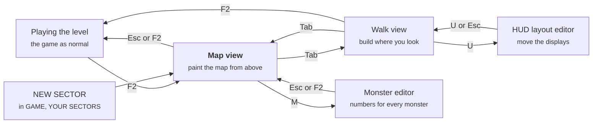

# NEON-CASTER Level Editor Guide

A sector takes five minutes to start: **GAME > YOUR SECTORS > NEW SECTOR**, paint floor (`.`) into the solid wall, **Tab** to walk it, **Ctrl+S** to save. Everything below is checked against `neon-caster.bas`.

- [Your first sector](#your-first-sector)
- [How the editor fits together](#how-the-editor-fits-together)
- [Map view](#map-view)
- [Walk view](#walk-view)
- [Every map character](#every-map-character)
- [Heights](#heights)
- [Lights](#lights)
- [Beyond the editor: the level file](#beyond-the-editor-the-level-file)
- [Building from the console](#building-from-the-console)
- [The monster and HUD editors](#the-monster-and-hud-editors)
- [Gotchas, and a checklist before you save](#gotchas-and-a-checklist-before-you-save)

## Your first sector

A playable sector needs only four things: walls all round the edge, one start, one exit, and a way to walk from the start to the exit. NEW SECTOR gives you all four. Everything else is decoration.

1. Open **GAME > YOUR SECTORS > NEW SECTOR**. You get sector 11 (then 12, up to 20), saved as `neon-caster/levels/custom/custom1.txt`. It's solid wall with one lit 8 × 8 room in the middle, cells 20 to 27 each way. You stand at (21, 24) facing east, and the exit `E` is at (28, 24).
2. You land in the **map view**: the level from above, with the palette on the right. The glyph you paint with is `#` (wall). Click `.` in the palette, the top-left square, to paint floor instead.
3. **Carve a room.** Hold **Shift**, press the left button on one corner, drag to the other corner and let go. The whole box becomes floor. Make sure it touches the starting room, or it's a sealed cave.
4. **Add a door** where the two rooms meet: pick `D` and click a wall cell that has floor on both sides and wall on the other two. Doors need a wall either side to slide into.
5. **Move the exit** if you like: right-click `E` to pick it up, paint it into a wall at the far end of your new room, and paint the old `E` back to `#`. A level should have exactly one exit.
6. **Put things in it.** Pick `m` (a drone), `+` (health) or `a` (energy cells), and click floor cells.
7. **Light it.** Press **L** for lights mode, press **1**-**8** for a colour (1 is white), and click where you want a light. Press **L** again to go back to painting.
8. **Walk it.** Press **Tab**. You're inside your level, frozen in time: monsters don't move and pickups aren't taken. Look around, then press **Tab** to go back to the map.
9. **Save** with **Ctrl+S**. The message warns you if there's no start, no exit, or a gap in the border, but it saves either way.
10. **Play it.** Press **Esc** to leave the editor, and the sector plays as a real level. Take the exit and it starts again. To come back later, it's in **GAME > YOUR SECTORS**.

To rename it, open the console (`` ` ``), type `sectorname MY FIRST MAP`, then `savelevel`.

Undo is **Ctrl+Z**, up to 40 steps, and one drag counts as one step.

## How the editor fits together



F2 in the game opens the map view; Tab flips between the map and walk views. M opens the monster editor from the map view, and U opens the HUD editor from either view (from the map view it opens over the walk view). Esc in the walk view opens the pause menu instead of leaving.

## Map view

The map view is where you shape the level: the whole 48 × 48 map from above, one square per cell, with a palette of 70 glyphs on the right. It has three modes. **Paint** is the normal one, **L** switches to lights, and **H** to heights; each of L and H switches the other off.

| Input | Paint mode | Lights mode (L) | Heights mode (H) |
| --- | --- | --- | --- |
| Left button | Paint the glyph; drag to keep painting (one undo step per drag) | Add a light in the cell, in the current preset | Raise the floor one eighth; with Shift, the ceiling |
| Shift + drag | Fill a box when you let go | | |
| Right button | Pick up the glyph under the mouse | Remove the nearest light within 1.5 cells | Lower the floor one eighth; with Shift, the ceiling |
| Wheel, `[` `]` | Previous / next glyph | Same | Same |
| Palette click | Choose that glyph | Same | Same |

| Key | Does |
| --- | --- |
| Tab | Walk view |
| Esc, F2 | Leave the editor and play |
| Ctrl+S | Save |
| Ctrl+Z | Undo (40 steps) |
| L | Lights mode on or off |
| H | Heights mode on or off. In this view H is **not** help; the help list is always on the right. |
| 1–8 | Light preset (below) |
| T | Move yourself to the cell under the mouse. It doesn't check for walls, so you can land inside one. |
| PgUp / PgDn | Previous / next sector, yours included. Refused while there are unsaved changes. |
| M | Monster editor |
| U | HUD layout editor |

You can't paint the outer ring of cells (x or y of 0 or 47), so the border always stays wall. Painting a new start (`<` `>` `^` `v`) turns the old one into floor, so there's never more than one.

**Light presets** all have radius 5 and brightness 140:

| Key | Preset | Colour | Effect |
| --- | --- | --- | --- |
| 1 | white | 230, 235, 255 | steady |
| 2 | cyan | 60, 220, 255 | steady |
| 3 | magenta | 255, 60, 220 | steady |
| 4 | orange | 255, 160, 60 | steady |
| 5 | green | 90, 255, 120 | steady |
| 6 | red alarm | 255, 40, 40 | strobe |
| 7 | flickering | 220, 230, 255 | flicker |
| 8 | firelight | 255, 150, 70 | fire |

**What the map shows.** Walls are drawn in their picture's average colour and floor is dark blue. Pickups are green squares, monsters red, decorations gold, and you're a yellow circle with a line showing which way you face. Lights are a ring in their colour; in lights mode their full reach is drawn too. Event rooms have a magenta outline and triggers an orange one. In heights mode, raised floors are shaded brown (brighter is higher), sunken floors purple, an unusual ceiling gets two cyan dots, and lifts get a green outline.

The line under the map names the cell under the mouse, as `x,y name`. x counts 0–47 left to right and y counts 0–47 top to bottom. Messages there are cut at 58 characters, so a long save warning can lose its end.

## Walk view

The walk view is the game, frozen, with a building cursor: you build onto whatever you're looking at. Monsters don't move, pickups aren't taken, events and triggers don't run, and the fire button doesn't shoot. You can still walk, open doors with Space, and ride lifts.

**How aiming works.** The editor looks up to 12 cells ahead along your view and stops at the first cell that isn't plain floor. That can be a wall, a door, glass, a pickup, a monster or a decoration; that's the **aimed** cell. The open cell just before it is the **front** cell. Building happens in the front cell and knocking down in the aimed cell. If nothing is within 12 cells, most keys do nothing. The box at the top left always says what you're aiming at and what you'd place.

| Input | Does |
| --- | --- |
| Left click | Place the selected glyph in the front cell |
| Right click | Turn the aimed cell into floor (never the border) |
| Tab | Back to the map view |
| F2 | Leave the editor and play |
| Ctrl+S, Ctrl+Z | Save, undo |
| `[` `]` | Previous / next glyph |
| E | Pick up the aimed cell's character as the glyph to place |
| T | Next picture for that kind of wall (`#` `N` `C` `K` `P` `G`). Every wall of that letter changes. Shift goes backwards. |
| F | Next picture for the front cell's floor (1–4), wherever that floor is used. Shift goes backwards. |
| V | Same for its ceiling (1–2) |
| Z | Give the front cell the next of the level's four floors |
| L | Add a light over the front cell, in the current preset |
| K | Remove the light nearest **you**, within 1.5 cells |
| 1–8 | Light preset |
| PgUp / PgDn | Front cell's floor up / down one eighth. Shift: its ceiling. |
| U | HUD layout editor |
| H | A help line |

**Every change rebuilds the level.** Killed monsters come back, pickups reappear, doors shut, and your keycards and map are taken away. You keep your position; if you end up inside something, you're moved to the nearest open cell.

**Game keys that still work here**, so mind them:

- **Esc** opens the pause menu; it doesn't leave the editor.
- **F** kicks as well as changing the floor picture, and the kick can hurt monsters and break decorations.
- **1–4** and the mouse wheel change guns as well as light presets.
- **G** toggles god mode, which lets you fly through walls: handy for getting into sealed rooms. **K** gives every keycard and the map as well as removing a light. Both are the testing cheats, on in this build.
- **Space on the exit** finishes the level, and the next one loads from its file, so unsaved edits are lost.
- **F9** quick-loads a saved game over your edits.
- You can still fall, burn and die, and dying reloads the level from its file.
- The console (`` ` ``) works here, but not in the map view.

## Every map character

Each cell of the map is one character, and case matters: `m` is a drone, `M` is the map pickup. Any character not listed here is plain floor. The palette shows them all in this order:

```
. # N C K P G /
\ D H X R B Y E
! = @ $ % & r b
y + * u a e 2 3
4 M q j m g h c
s k w z T o i p
t x l n f S d A
F I J L O Q U W
Z V < > ^ v
```

**Walls and structure**

| Char | What | Notes |
| --- | --- | --- |
| `.` | Floor | |
| `#` `N` `C` `K` `P` `G` | Solid walls | They differ only in looks: pictures 1–6 of the level's `walls =` list, in that order. `#`'s picture is also used for the steps between floor heights. |
| `/` `\` | Diagonal walls | Half wall, half floor, corner to corner. The solid half is chosen from the walls next to it, and it takes their look. You can't walk through one. |
| `%` | Secret wall | Looks like the walls around it. Slides away when a closet event (kind 6) within 3 cells goes off. |
| `=` | Glass | A see-through pane. Put it in a straight wall one cell thick. 4 hits break it. |
| `@` | Data station | A wall you jack into with Space. Hacking it opens nearby `!` doors. |
| `$` | Code terminal | A wall with a QB64 puzzle: the next name from `puzzles =`, in reading order. |
| `&` | Teleporter | Pads pair up in reading order: 1st with 2nd, 3rd with 4th. Up to 16. |

**Doors.** A door must sit between two walls.

| Char | What | Opens |
| --- | --- | --- |
| `D` | Sliding door | Space; stays open 4 s |
| `H` | Shutter, rolls up | Space; slower, open 6 s |
| `X` | Split door | Space; fastest, open 3 s |
| `R` `B` `Y` | Key door | Needs the red, blue or yellow keycard |
| `!` | Sealed door | Opens when the nearest data station `@` is hacked |
| `E` | **The exit** | Never opens; Space on it ends the level. Gets a green pulsing light. |

**Pickups.** Up to 64 per level.

| Char | Pickup | | Char | Pickup |
| --- | --- | --- | --- | --- |
| `r` `b` `y` | Red / blue / yellow keycard | | `u` | Armour +50 |
| `+` | Health +25 (up to 100) | | `*` | Big medkit +50 |
| `a` | Energy cells +15 | | `4` | Railgun, +30 cells |
| `e` | Shells +8 | | `M` | The map |
| `2` | Scatter gun, +8 shells | | `q` | Overcharge +100, up to 200 |
| `3` | Repeater, +30 cells | | `j` | Damage amp: double damage for 30 s |

**Monsters.** Up to 64 per level, counting ones events spawn.

| Char | Monster | Hits to kill |
| --- | --- | --- |
| `m` | drone | 3 |
| `g` | gunner | 4 |
| `h` | heavy | 10 |
| `c` | crawler | 2 |
| `s` | sentry | 8 |
| `k` | stalker | 3 |
| `w` | spitter | 6 |
| `z` | overseer (boss) | 80 |
| `T` | thief | 5 |

**Decorations.** Up to 64 per level. They block your way, and most can be shot to pieces.

| Char | Thing | | Char | Thing |
| --- | --- | --- | --- | --- |
| `o` | Barrel (explodes) | | `A` | Control console (glows) |
| `i` | Lamp (cyan light) | | `F` | Wall of screens (glows) |
| `p` | Plant | | `I` | Specimen tank (glows) |
| `t` | Terminal (green pulse) | | `J` | Lab bench |
| `x` | Crate | | `L` | Generator (fire glow) |
| `l` | Server rack (blinks) | | `O` | Cryo pod (glows) |
| `n` | Vending machine (pink) | | `Q` | Hologram (glows) |
| `f` | Coolant tank (explodes) | | `U` | Lockers |
| `S` | Spawner (the portal nest events use) | | `W` | Bench |
| `d` | Desk | | `Z` | Chair |
| | | | `V` | Body (doesn't block, can't break) |

**The start.** `<` `>` `^` `v` put you there, facing left, right, up or down the map. Keep exactly one.

## Heights

Every cell has its own floor and ceiling height, measured in **eighths of a wall**. The usual floor is 0 and the usual ceiling is 8 (one wall up). You can step up 2 eighths, but 3 eighths blocks you, so make stairs from 2-eighth steps.

**Raising and lowering**

- **Map view:** press **H**, then click to raise a cell's floor one eighth and right-click to lower it. Hold **Shift** to move the ceiling instead.
- **Walk view:** look at the cell and press **PgUp** or **PgDn**. Hold **Shift** for the ceiling.
- **Console:** `raise X Y EIGHTHS` for one cell, or `raise X0 Y0 X1 Y1 EIGHTHS` for a box; add `ceil` for the ceiling.

| Rule | Value |
| --- | --- |
| Highest step you can walk up | 2 eighths (the limit is 0.32 of a wall) |
| Lowest gap you can walk under | 6 eighths of room between floor and ceiling |
| A floor can't go above | its ceiling minus 2 eighths |
| A floor can't go below | −8, a bottomless pit: fall in and you die |
| A drop that hurts | about 8 eighths (a whole wall); 7 doesn't |

With the usual ceiling, a floor tops out at 6 eighths. Raise the ceiling first to build higher. When the editor refuses a change, it says nothing, so if a click seems to do nothing, check the ceiling.

**In the level file**, heights are two extra maps, `[floor]` and `[ceiling]`, one character a cell:

| Char | Means |
| --- | --- |
| `.` | The usual: floor 0, ceiling 8 |
| `0`–`9`, `a`–`z` | 0 to 35 eighths up: `8` is one wall, `g` is two, `z` is 4⅜ |
| `A`–`H` | 1 to 8 eighths down; `H` is a pit |

Case matters here too: `a` is 10 up, `A` is 1 down. A level with neither section is flat and draws the fast classic way.

**Floor hazards** come from the floor picture's name: a floor whose picture name contains `molten` or `lava` burns you, and `murky` or `slime` slows you down.

## Lights

A level is lit by one **ambient** level everywhere, plus up to 96 **lights** that stop at walls. The editor places lights from the 8 presets; for any other colour, size or effect, edit the numbers in the level file.

**`ambient = brightness, red, green, blue`** sets the base light. Brightness runs 0–256, where 256 shows every picture in its own colours; the other three tint it (0–255). NEW SECTOR uses `165, 225, 220, 255`, a cool dim blue.

**`[lights]`** has one line per light: `x, y, radius, brightness, red, green, blue, effect`.

| Field | Meaning |
| --- | --- |
| `x`, `y` | Where, in cells. `20.5` is the middle of cell 20. |
| `radius` | How far it reaches, in cells. It fades to nothing at the edge. |
| `brightness` | 0–400, added on top of the ambient light |
| `red`, `green`, `blue` | Its colour, 0–255 each |
| `effect` | 0 steady · 1 flickering tube · 2 slow pulse · 3 alarm strobe · 4 firelight · 5 dying tube |

No preset uses effects 2 or 5; set those by hand.

**The 96-light budget includes automatic lights.** Lamps, terminals, server racks, glowing decorations, the exit and teleporter pads each add a light of their own. Past 96, extra lights are dropped without a message, and the editor can't warn you because it only counts the level's own list. If a light you placed doesn't show, you've probably hit the limit.

The console can switch a light while you play: `light N on` or `light N off`, where N counts the `[lights]` lines from 1. A trigger can do the same.

## Beyond the editor: the level file

Some things have no editor tool yet: events, lifts, triggers, the name and the puzzles. Write them into the level file, `neon-caster/levels/custom/customN.txt`, in any text editor, then reload the sector. The file is plain text: `key = value` lines at the top, then `[sections]`, and lines starting with `'` are comments.

Ctrl+S rewrites the whole file in a fixed layout. Only the comments at the very top survive, so keep your notes there.

**Pictures.** `walls =` needs exactly 6 picture names (for `# N C K P G`), `floors =` 4 and `ceilings =` 2. A misspelled name makes the game quit with "Missing texture". These are the pictures in `neon-caster/`:

- **Walls:** wall, wall2, wall-adverts, wall-biolab, wall-brick, wall-coils, wall-concrete, wall-control, wall-core, wall-cryo, wall-datastream, wall-frost, wall-furnace, wall-girders, wall-graffiti, wall-grate, wall-greenhouse, wall-greenpipes, wall-hazard, wall-hull, wall-ice, wall-moss, wall-obsidian, wall-pipes, wall-reactor, wall-rusty, wall-servers, wall-slime, wall-stripes, wall-terminals, wall-tiles, wall-transit, wall-vault, wall-viewport, wall-vines, wall-white. (`wall-jack` and `wall-code` are the data station's and code terminal's own.)
- **Floors:** floor, floor-circuit, floor-cobbles, floor-concrete, floor-core, floor-deck, floor-frostgrate, floor-glow, floor-hazard, floor-ice, floor-lab, floor-molten (burns), floor-murky (slows), floor-plates, floor-platform, floor-rustgrate, floor-scorched, floor-soil, floor-white.
- **Ceilings:** ceiling, ceiling-cables, ceiling-core, ceiling-frost, ceiling-girders, ceiling-growlights, ceiling-hull, ceiling-lights, ceiling-pipes, ceiling-stone, ceiling-tunnel, ceiling-vents, ceiling-warning.

All end in `.png`. In the walk view, **T**, **F** and **V** step through these without typing anything.

**`[zones]`** choose which of the 4 floor and 2 ceiling pictures each area uses: `x0, y0, x1, y1, floor, ceiling, shape`. `floor` is 1–4 and `ceiling` 1–2 (0 leaves it alone). `shape` 0 is the whole rectangle; 1–4 is the top-left, top-right, bottom-right or bottom-left triangle of a square. Later zones win where they overlap. The walk view's **Z** adds a one-cell zone. Up to 64.

**`puzzles = NAME, NAME, …`** gives each `$` code terminal its puzzle, in reading order, from `neon-caster/puzzles/`: countdown, function, hello, multiply, password, pythagoras, reverse, select, sum, wrap.

**`[events]`** are rooms that do something when you walk in: `kind, x0, y0, x1, y1, a, b, reward`. Doors within 5 cells of the room belong to it. Up to 16.

| Kind | Event | `a` | `b` |
| --- | --- | --- | --- |
| 1 | Ambush | How many monsters | Monster type (0 = a mix) |
| 2 | Survive | Seconds | Frames between arrivals |
| 3 | Trap | Frames live | Frames safe |
| 4 | Gallery | Seconds to break every decoration in the room | |
| 5 | Nest | Monster type | Frames between spawns |
| 6 | Closet | | (opens `%` walls within 3 cells) |
| 7 | Hoard | | (sealed until every thief is dead) |
| 8 | Plate | Frames until the blast | Frames until it re-arms |
| 9 | Laser | Frames on | Frames off (0 = always on) |
| 10 | Cutter | Frames per sweep | |
| 11 | Blackout | Seconds | Number of monsters |

Monster types are numbered in the order of the monster table: 1 drone to 9 thief. `reward` is a pickup given when you win, numbered in this order: 1 red card, 2 blue card, 3 yellow card, 4 health, 5 cells, 6 shells, 7 scatter gun, 8 repeater, 9 armour, 10 medkit, 11 railgun, 12 map, 13 overcharge, 14 amp. Use 0 for none. Only ambush, survive, trap and gallery give one. A trap or cutter with `a` of 0 is a mistake: it logs an error.

**`[lifts]`**: `x0, y0, x1, y1, low, high, mode, speed`. `low` and `high` are in eighths and `speed` is eighths a second. `mode` 1 goes up and down by itself, 2 is an elevator (up when you step on, down after you step off), and 3 moves only when a `liftgo` command says so. Up to 16.

**`[triggers]`** run console commands when something happens: `WHEN [repeat] : COMMAND ; COMMAND`.

| WHEN | Fires when |
| --- | --- |
| `enter X0 Y0 X1 Y1` | You step into the rectangle |
| `use X Y` | You press Space facing that cell |
| `clear X0 Y0 X1 Y1` | Every monster that started in the rectangle is dead |
| `time S` | S seconds into the level |

Without `repeat`, a trigger fires once. Don't put `repeat` on `time` or `clear`: once true they stay true, so the trigger fires every frame. If you start inside an `enter` rectangle, it waits until you leave and come back. Up to 48. For example:

```
enter 20 20 22 22 : message AMBUSH! ; summon stalker 3
use 30 14 : door 31 14 open ; sound alarm
```

## Building from the console

The console (`` ` ``, in the game or the walk view) can build with exact coordinates, which is quicker than clicking for big shapes. Put several commands on one line with `;`, and press Tab to finish a command's name. The building commands work even outside the editor, but each one rebuilds the level, so monsters and pickups reset.

| Command | Does | Kept by Ctrl+S? |
| --- | --- | --- |
| `edit` / `edit walk` / `edit off` | Open the editor at the map or walk view, or close it | |
| `put X Y CHAR` | Put one character in a cell | Yes |
| `box X0 Y0 X1 Y1 CHAR` | Fill a rectangle (one undo step) | Yes |
| `raise X Y EIGHTHS [ceil]` | Raise (or lower, with a minus) one cell's floor or ceiling | Yes |
| `raise X0 Y0 X1 Y1 EIGHTHS [ceil]` | The same for a rectangle | Yes |
| `lamp X Y [1-8]` | A light over a cell, in a preset | Yes |
| `lift X0 Y0 X1 Y1 LOW HIGH [MODE] [SPEED]` | Add a lift (mode 2 and speed 8 unless you say) | Yes, but Ctrl+Z can't remove it |
| `trigger WHEN : CMD \| CMD` | Add a trigger; `\|` separates its commands. `trigger del N` removes one. | Yes, but Ctrl+Z can't remove it |
| `triggers` | List the level's triggers | |
| `undo` / `savelevel` | Same as Ctrl+Z / Ctrl+S | |
| `newsector` | A new blank sector of your own, in the editor | |
| `sectorname NAME` | Rename the sector you're in | After `savelevel` |
| `map 11` / `maps` | Go to a sector by number (or part of its name) / list them all | |

These only change the running level, so they're for testing and for triggers rather than building:

| Command | Does |
| --- | --- |
| `door X Y open\|close\|lock\|unlock\|toggle` | Work a door |
| `wall X Y CHAR` | Swap a wall (`#` `.` `N` `C` `K` `P` `G`) until the next rebuild |
| `light N on\|off` | Switch one of the level's lights |
| `liftgo N up\|down` | Send a lift |
| `message TEXT` | Show a message |
| `sound NAME` | Play `sfx/NAME.wav` |

`help` doesn't list most of these yet, but Tab completes them all. Two worth knowing for testing: `summon TYPE [N]` puts monsters in front of you, and `god` stops them hurting you.

A room by console, as an example (sector made with NEW SECTOR):

```
box 29 21 36 27 . ; put 28 24 D ; put 37 24 E ; lamp 32 24 2 ; savelevel
```

That carves a second room east of the first (both corners are included), turns the old exit at (28, 24) into a door between the rooms, puts the exit in the new room's east wall, and lights the room cyan. There's still exactly one exit.

## The monster and HUD editors

Both change files that every sector shares, not the sector you're in.

**Monster editor** (**M** in the map view, or `monsters` in the console) sets the numbers for each kind of monster, saved to `neon-caster/monsters.txt`. Changes take effect at once, except hit points, which apply to monsters placed after the change.

| Key | Does |
| --- | --- |
| PgUp / PgDn | Choose the monster |
| Up / Down | Choose the number |
| Left / Right | Change it; Shift changes it 10 steps at a time |
| S | Save `monsters.txt` |
| Esc, F2 | Back |

The numbers: hit points (1–200), speed, height, hover, bob, reach, damage (plus a random extra up to a limit), cooldown between attacks, whether it shoots, what it drops and the chance it drops it.

**HUD layout editor** (**U** in either view, or `hud` in the console) moves the on-screen displays, over the frozen game, and saves to `neon-caster/hud.txt`. Delete that file to get the game's own layout back.

| Key | Does |
| --- | --- |
| Drag | Move the part under the mouse |
| Tab | Next part |
| Arrows | Nudge 1 pixel; Shift, 8 |
| V | Show or hide it |
| C | Next colour |
| `+` / `-` | Wider / narrower (the minimap and keycards: bigger / smaller) |
| `[` / `]` | Shorter / taller |
| S | Save `hud.txt` |
| R | The game's own layout (S to keep it) |
| U, Esc | Leave |

The parts are health, armour, ammo, guns, kills, minimap, keycards, message, subtitle, amp, god mode, event, network and FPS.

## Gotchas, and a checklist before you save

The editor trusts you: it saves a level with no start, no exit or a gap in its walls, and only warns. Nothing in the game checks that keys can be reached or that doors have walls on both sides.

**Before you save:**

- [ ] Exactly one start (`<` `>` `^` `v`) and exactly one exit `E`
- [ ] The exit sits in a wall, with floor in front of it
- [ ] You can walk from the start to the exit, using only keycards you can reach first
- [ ] Every door has a wall on both sides
- [ ] Glass is in a straight wall one cell thick
- [ ] Steps are 2 eighths or less, and gaps you walk under are at least 6 eighths
- [ ] A map pickup `M` somewhere, or the minimap never appears
- [ ] Picture names in the file are spelled right (a wrong one quits the game)

**Check it with the level kit.** `levels.py --check` only checks the game's own ten sectors, but its checker works on one of yours too. From `neon-caster/levels/`:

```
python3 -c "import lvlkit; lvlkit.check_level(lvlkit.read_level_file('custom/custom1.txt','custom1'), '..')"
```

It reports anything you can't reach, doors without walls, a missing start or exit, and more. Never run `levels.py --write` on a level you've edited by hand or in the editor: it regenerates all ten game sectors from the kit and overwrites them. Your own sectors in `custom/` are safe from it.

**Things that lose your work:**

- Leaving the editor doesn't save. You play the edited level, but dying, taking the exit, loading a game or quitting reloads it from the file.
- Ctrl+Z can't undo you back to "saved": after any undo, PgUp/PgDn still says to save first. Save, or leave and accept losing the edits.
- Going back into the editor clears the "not saved" marker even though the edits are still unsaved.
- In the walk view, Space on the exit and F9 (quick-load) both reload the level from its file.

**Other surprises:**

- Every edit rebuilds the level: dead monsters come back and your keycards are taken away.
- The walk view's aim stops at the first thing that isn't floor, including pickups and monsters, so you may build in front of a crate rather than the wall behind it.
- Ctrl+S keeps only the comments at the very top of the file; everything else is rewritten in a fixed layout.
- Lights over 96 in total (automatic ones included) are dropped silently.
- Undo doesn't cover lifts, triggers, events, the name or the ambient light.
- There's no in-game way to delete one of your sectors: delete its file in `neon-caster/levels/custom/`. The `.bak` file next to it is the editor's backup copy of the level.
