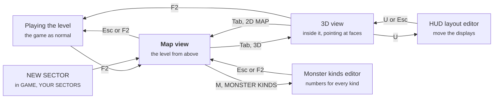

# NEON-CASTER Level Editor Guide

A sector takes five minutes to start: **GAME > YOUR SECTORS > NEW SECTOR**, then carve rooms, put things in them and save. You can build from above on the map, or from inside, pointing at walls and floors with the mouse. Everything below is checked against `neon-caster.bas`.

- [Your first sector](#your-first-sector)
- [How the editor fits together](#how-the-editor-fits-together)
- [The toolbar and the picker](#the-toolbar-and-the-picker)
- [The 3D view](#the-3d-view)
- [Shaping: the wheel, the arrows, Delete](#shaping-the-wheel-the-arrows-delete)
- [Pictures on faces, and Divide](#pictures-on-faces-and-divide)
- [The properties pane](#the-properties-pane)
- [The map view](#the-map-view)
- [Every map character](#every-map-character)
- [Heights](#heights)
- [Liquids](#liquids)
- [Blocks: less than a cell](#blocks-less-than-a-cell)
- [Lights](#lights)
- [Beyond the editor: the level file](#beyond-the-editor-the-level-file)
- [Building from the console](#building-from-the-console)
- [The monster and HUD editors](#the-monster-and-hud-editors)
- [Gotchas, and a checklist before you save](#gotchas-and-a-checklist-before-you-save)

## Your first sector

A playable sector needs only four things: walls all round the edge, one start, one exit, and a way to walk from the start to the exit. NEW SECTOR gives you all four. Everything else is decoration.

1. Open **GAME > YOUR SECTORS > NEW SECTOR**. You get the first free sector number - 22, since the examples below are 11 to 21 and 24 - up to 40 (past 20 they're under **MORE SECTORS**), saved as `neon-caster/levels/custom/customN.txt`, N ten less than the sector (sector 22 is `custom12.txt`). It's solid wall with one lit 8 × 8 room in the middle, cells 20 to 27 each way. You stand at (21, 24) facing east, and the exit `E` is at (28, 24).
2. You land in the **map view**: the level from above. Press **Tab** (or the **3D** button) to be inside it instead. Either way, the **toolbar** has the tools and the **picker** has everything you can put in a level.
3. **Push a wall back.** In the 3D view, click a wall to select it, then hold **Shift** while you turn the wheel up (away from you): the wall goes back a cell at a time and the room grows. Turn it down, towards you, and the wall comes out towards you - the wall goes the way the top of the wheel goes.
4. **Carve a room from above.** In the map view, choose **PLACE**, open the picker's **SPECIAL** tab and click the floor tile, then hold **Shift** and drag a box. The whole box becomes floor. Make sure it touches the first room.
5. **Add a door.** Picker, **DOORS** tab, click the sliding door, then click the wall cell between the rooms. Doors need a wall either side to slide into.
6. **Put things in it.** The **MONSTERS** and **ITEMS** tabs. In the 3D view a see-through copy shows where each one will go before you click.
7. **Light it.** The **LIGHTS** tab: click an effect and a colour, then click a wall or a floor.
8. **Save** with **SAVE** or **Ctrl+S**. The message warns you if there's no start, no exit, or a gap in the border, but it saves either way.
9. **Play it.** **F2** leaves the editor and the sector plays as a real level. Changes you haven't saved stay while you play: die and it starts again as you edited it, and an edit made on the way keeps the keycards and map you'd picked up. To come back later, it's in **GAME > YOUR SECTORS**.

To rename it, open the console (`` ` ``), type `sectorname MY FIRST MAP`, then `savelevel`.

**Twelve examples to take apart.** YOUR SECTORS starts with twelve sectors built to show the editor off (so your first NEW SECTOR is number 22, and there's room for eight of yours - 24 is taken; delete an example's file in `neon-caster/levels/custom/` for more): **11, THE GALLERY** (pictures on single faces, a checkerboard floor laid cell by cell, two-tone pillars, paintings lit and tinted by lights on their faces, statues that wake only when shot and guards that hear it), **12, THE SUNKEN DEPOT** (a walkway a wall up, a shaft with no bottom and a causeway across it, beams hanging from the dark, firelight on the furnace wall, crawler closets, a stalker hunting you from the start), **13, THE RELAY** (chambers only teleporters reach, each pad LINKed to its own, each chamber in pictures of its own), **14, THE CONSERVATORY** (a floor woven from divided cells, a bottomless pond crossed on lifts that each rise and fall at their own pace, a garden behind glass, and the light lab: all six ways a light can go, side by side), **15, THE LISTENING POST** (guards that see four cells but hear a shot from fourteen, crawler closets, a room you must survive for the blue card, an archive locked by a timed trigger and opened by a USE trigger on a terminal) **16, THE OBSERVATORY** (a tower climbed by stairs, an elevator and a lift that rises and falls by itself, glass windows, each ledge lit its own colour, and pads LINKed out of reading order), **17, THE FLOODED ARCHIVE** (a hall under murky water - its floor painted `floor-murky` cell by cell, and a floor's picture says what it does: you wade - crawlers among the shelves, a fallen catwalk, dying lights), **18, THE CORE** (a reactor glowing red on an island in a ring of molten metal painted to burn, bridges that are lifts rising and falling each at its own pace, fire traps, strobing alarms), and three outdoors under skies: **19, THE ROOFTOPS** (night over the neon city, roofs joined by bridges over alleys that are a death pit), **20, THE STORM YARD** (a shipyard under lightning, containers to climb, puddles that slow you) and **21, THE DRIFT** (platforms adrift in orbit over a bottomless void, crossed by catwalks, lifts and LINKed pads), and **24, THE NEON EXPO**: every feature in one sector - eight pavilions round a grand atrium, all thirteen kinds of event room, every kind of trigger, all five liquids, blocks and alcoves, standing decorations, lifts that bob or are called from a console, a skydeck over a street that kills, and the overseer on the summit (built by `neon-caster/levels/megasector.py`). Open one with F2 and click about: the panes show how each thing is set up. They're made by `neon-caster/levels/showcase.py`, which writes them again from scratch, so don't run it once you've changed them.

Undo is **UNDO** or **Ctrl+Z**, up to 40 steps. One drag, or one run of wheel turns, counts as one step. **F1** (or **HELP**) shows every key for the view you're in.

## How the editor fits together



Both views edit the same level and share one **selection**, one **tool** and one **brush**, so you can select from above and shape from inside. Esc in the 3D view opens the pause menu instead of leaving.

The world is a grid of cells, 48 × 48. Walls fill whole cells, and each cell has one floor height and one ceiling height. So walls move a whole cell at a time, heights move an eighth of a wall at a time, and **Divide** (below) splits a face's *picture* in two, not the wall itself.

## The toolbar and the picker

**The toolbar** runs along the top of the 3D view, and down the panel on the right of the map view. Point at a button for a line saying what it does.

| Button | Does |
| --- | --- |
| SELECT | A click selects (the default tool) |
| PLACE | A click puts the brush there: a wall, a door, a thing |
| PAINT | A click gives a face the brush's picture |
| LIGHT | A click puts a light on a face |
| HEIGHT | A click raises a floor or ceiling an eighth; Shift+click lowers it |
| DELETE | Deletes the selection (also **Del**) |
| UNDO, SAVE | Ctrl+Z, Ctrl+S |
| GRID, and the slider | Lines on every cell's edge, drawn into the world, and how strong they are (also **G**, and **Shift+G**) |
| PICKER | 3D only: the picker tucked away (it opens when the pointer reaches the bottom of the screen), always open, or off (also **P**) |
| SECTOR | The sector's own pane: its name, its light, and the pictures of its six kinds of wall, four floors and two ceilings |
| 2D MAP / 3D | The other view (also **Tab**) |
| HELP | The cheatsheet for this view (also **F1**): every key, click and wheel turn, grouped; F1 or a click closes it |
| < SECT, SECT > | Map view only: the sector before or after (PgUp, PgDn). With unsaved changes it asks first: press it again within three seconds to go anyway and lose them. |
| MONSTER KINDS | Map view only: the monster kinds editor (M) |

**The picker** is everything you can put in a level, as pictures: along the bottom in the 3D view (two rows of eight), and under the title in the map view (three rows of four). The wheel over it, or the arrows beside it, scroll it.

| Tab | Has |
| --- | --- |
| WALLS | The six wall types `#` `N` `C` `K` `P` `G` in their pictures, the diagonals, the secret wall, glass; then every wall picture there is |
| FLOORS, CEILINGS | Every floor and ceiling picture |
| DOORS | Sliding, shutter, split, the three key doors, the sealed door, the exit |
| ITEMS | Keycards, health, armour, ammo, guns, the map, overcharge, the amp |
| MONSTERS | All nine |
| DECOR | All 21 decorations |
| SPECIAL | The start (four ways round), the teleporter pad, the data station, the code terminal, plain floor |
| LIGHTS | The six ways a light can go (steady, flicker, pulse, strobe, fire, dying), each shown going, in the brush's colour; then twelve colours |
| LIQUIDS | DRAIN, then water, poison, slime, lava and acid, each 2, 4 and 6 eighths deep: pick one and PAINT pours it (see [Liquids](#liquids)) |

Click one and it's the **brush**, and the tool that uses it is chosen for you: a map character picks PLACE, a picture picks PAINT, an effect or colour picks LIGHT. If something is **selected** when you click, it's done to the selection at once: the character is put in every selected cell (for a wall face, the cell in front of it), the picture painted on every selected face, the effect or colour given to every selected face's light.

## The 3D view

The game, frozen, with a mouse pointer. Monsters don't move, pickups aren't taken, events and triggers don't run, nothing hurts you, the gun is put away and you fly.

| Input | Does |
| --- | --- |
| Mouse | Points. Whatever's under the pointer is outlined in pulsing cyan and named: a WALL, FLOOR, CEILING, STEP (the face of a floor stepping up) or LINTEL (the face of a ceiling stepping down), its cell and side - or a monster, pickup or decoration by name |
| Right button (hold) | Look round instead; the crosshair picks while you do |
| Your walk keys | Fly, straight through walls |
| Space, C | Up, down (Shift: faster), as high as a sector goes - 30 walls |
| Look up (or down) and walk | Climb (or sink) as you go - OpenGL, with LOOK UP / DOWN on |
| Left click | The tool (below) |
| Wheel | Shape what's selected (next section) - never just what's under the pointer |
| Ctrl+D | Select nothing |
| Del | Delete the selection |
| H, V | Divide a face left / right, top / bottom |
| G, Shift+G | The grid, and how strong it is |
| P | The picker: tucked away, always open, off |
| F1 | The cheatsheet: every key, click and wheel turn, by what it's for |
| Tab | The map view |
| F2 | Leave the editor and play |

**The tools, in 3D:**

| Tool | Click | With Shift | With Ctrl | With Alt |
| --- | --- | --- | --- | --- |
| SELECT | Select the face (or thing) | Add it to the selection, or take it out | The whole floor or ceiling it's part of: every cell joined to it at the same height | |
| PLACE | Put the brush in the cell: a floor's own cell, a wall's the cell in front. Hold the button and sweep to place along the floor. | Take away the thing there | | Pick it up as the brush |
| PAINT | The brush's picture on the face (on the half, if it's divided) | The usual picture again | The whole floor or ceiling | Pick its picture up as the brush |
| LIGHT | A light on the face, as the light brush is. A face that has one is selected instead, for its pane. | Take the face's light away | | |
| HEIGHT | Raise the floor or ceiling an eighth | Lower it | | |

In PLACE, a magenta box on the floor and a see-through copy of the brush show where it will go before you click. Monsters, pickups and decorations can be clicked: they select their cell.

The older keys still work, aimed along the middle of the view: **T** steps every wall of the aimed letter through the wall pictures (Shift: back), **F** the front cell's floor picture, **Z** gives the front cell the next of the level's four floors, **L** a light over the front cell and **K** takes away the light nearest you, **PgUp**/**PgDn** the front cell's floor (Shift: its ceiling), **E** picks up the aimed cell's character, `[` `]` step the brush, **1**-**8** a light preset, **U** the HUD layout editor.

**Every change rebuilds the level.** Killed monsters come back, pickups reappear, doors shut, and your keycards and map are taken away. You stay where you are.

## Shaping: the wheel, the arrows, Delete

**The wheel** works on the selection, and only the selection: with nothing selected it changes nothing (click a face first). The face under the pointer is never changed just because the pointer is on it. A pause of half a second starts a new undo step.

| On | Wheel up / down |
| --- | --- |
| A floor, a step's face | Its floor up / down an eighth (Ctrl: a whole wall) |
| A ceiling, a lintel's face | Its ceiling up / down an eighth (Ctrl: a whole wall) |
| A wall, with Shift | Push the wall back a cell / pull it out towards you (it goes the way the top of the wheel goes). Pushing opens the cell and gives it the floor and ceiling of the cell in front. |
| A wall, with Alt | The other way round: pull it out / push it back |
| A wall, with Ctrl+Shift | Make it a block standing on the floor; keep turning to set its top |
| A wall, with Alt+Shift | Make it a block hanging from the ceiling; keep turning to set its bottom |

Rough a level out this way: Shift+wheel walls back to make rooms and corridors, wheel floors down for pits and up for platforms, Ctrl+Shift for a counter or a crate-sized block, Alt+Shift for a low beam to duck under.

**The arrows** move the selection's cells a cell: in 3D, away from you, back, left and right as you face (whichever way along the grid is nearest); on the map, up the screen is north. Everything in a cell goes with it: what's there, its floor and ceiling, a monster's own settings. A cell left behind becomes like the cell behind it, so a platform slides along leaving floor like the floor round it. Nothing moves into the border, and a start is never copied.

**Delete** (Del, or DELETE): a selected wall is opened up (its floor and ceiling like the cell in front), a thing on a selected floor is taken away (never the start), and a selected step or lintel is flattened to the floor or ceiling in front of it.

## Pictures on faces, and Divide

Any face can have a picture of its own: a wall's side, a step's or lintel's face, a floor, a ceiling. Pick a picture in the picker (it chooses PAINT) and click faces. **Ctrl+click** paints a whole floor or ceiling - or a wall's whole side: every face along it in the same plane with open floor in front, as far as it goes (your selection stays as it was), **Shift+click** puts back the usual picture, **Alt+click** picks a face's picture up. Picking a picture with faces selected paints them all. From above, PAINT paints a cell's floor (Ctrl: its ceiling), or all four sides of a wall.

**Divide** splits a face in two for pictures. Select a face (or several) and press **H** for left | right or **V** for top | bottom; press it again to make the face whole. The halves start with the face's picture. Each half is outlined on its own when you point at it ("half 1", "half 2"), can be selected on its own, and painted on its own. A floor or ceiling divides west | east (H) or north | south (V). Top | bottom splits at the face's middle height, so on a tall wall it may be above your eye.

Both renderers draw every picture and half. A sector can use up to **24** pictures of its own on faces, counting the tinted copies lights make (below); past that, extra ones are ignored without a message.

## The properties pane

Select something and its pane opens: on the right in the 3D view, over the map's right side in the map view. Changes apply to everything selected of that kind.

| Selected | The pane |
| --- | --- |
| A door | Its kind: SLIDING, SHUTTER, SPLIT, SEALED, RED KEY, BLUE KEY, YELLOW KEY, EXIT |
| A teleporter pad | Where it goes. **LINK...** and then click another pad to pair the two (saved as `[pads]`); **UNLINK** returns it to pairing in reading order. In 3D every pair is joined by a purple line. |
| A face with a light | Its colour (twelve), effect (six), REACH and BRIGHT, REMOVE THE LIGHT. The swatch in the corner shows it going. |
| A monster | SIGHT, HEARING, HEALTH and SPEED, and what WAKES it; AS ITS KIND IS resets it. Its sight (cyan) and hearing (yellow) are drawn as rings on the floor round it. |
| A floor of a lift | LOW, HIGH and SPEED in eighths, the mode (click it: UP AND DOWN, ELEVATOR, ON A TRIGGER - moves only on `liftgo`, CRUSHER, SMASHER - see below), REMOVE |
| An event room (EVENT ROOM... on a floor's pane) | Its kind (AMBUSH, SURVIVE, TRAP, GALLERY, NEST, CLOSET, HOARD, PLATE, LASER, CUTTER, BLACKOUT, FIRETRAP, DEATHPIT - switching kind gives it numbers that suit), its two numbers by what they mean for that kind (how many monsters and of what kind, how long, live and safe times, how often), the PRIZE for winning it (ambush, survive, trap, gallery), REMOVE THE EVENT, BACK (to the floor's pane). The table under `[events]` below says what each kind does. |
| A block's side | Its edges in eighths; PUSH IN and PULL OUT move the selected side an eighth (every block side selected); LOOKS LIKE THE WALL: `#` `N` `C` `K` `P` `G`; REMOVE THE BLOCK; ADD A LIGHT TO IT |
| Floor | MAKE A LIFT OF IT (the selected cells' box, from their floor up a wall), MAKE AN EVENT ROOM (the same box, an ambush to start with) - or, on a floor already in one, EVENT ROOM: its kind..., which opens that room's pane, ADD A PILLAR (a block a quarter of a cell square, in the middle), CELL LIGHT... (the cells' own ambient light - see Lights), ADD A LIGHT TO IT - and, with a decoration on it, MOVE IT `<` `>` `^` `v`, an eighth at a time, and which way it faces: TURNS TO FACE YOU (as every sprite does), or STANDS, FACING EAST / SOUTH / WEST / NORTH (these rows are on a light's pane too, when the light is over the decoration) |
| A plain wall | MAKE IT A BLOCK (the wall becomes a block filling its cell, its sides' pictures kept, and the side you clicked stays selected, ready to PUSH IN), ADD A LIGHT TO IT |
| Any other face | ADD A LIGHT TO IT |
| TRIGGERS... (on a door's, a floor's, a wall's pane) | The triggers about the selection: an enter or clear box taking it in, a use of it, and the timed ones (which are everywhere), each with an **x** to take it away. Then a new one: ENTER (walking into the selection's box - for a wall, the cells in front of it), USE (Space facing the first face's cell: a wall, a door, a terminal), CLEAR (every monster that started in the box is dead) or TIME (seconds into the level); JUST ONCE or EVERY TIME; TYPE its commands as in the console, `;` between them, or click the action buttons (+25 HP, -25 HP, DIE, +CELLS, -CELLS, +SHELLS, -SHELLS, GIVE ALL, TAKE ALL) to add theirs; ADD IT. |
| Nothing (the SECTOR button) | NAME: type the sector's name, Enter to keep it (Esc not). LIGHT: the ambient light, brighter or darker, and twelve colours to tint it. DROIDS: how many service droids roam it (0-12). ALL FLOORS / ALL CEILINGS: every floor (or ceiling) in the sector down or up an eighth - Shift, a whole wall. LOOT: what every breakable leaves, at once - AS MADE (the game's table), NONE, LITTLE (half the chances), PLENTY (half again), LOTS (twice); the console's `loot` sets one kind exactly. ROOM W x H (- and +; Shift for its depth) and MAKE THE MAP THIS ROOM: the whole map wall again but for one room that size in its middle, you at its west end, the exit in its east wall - the quick start for a new sector (Ctrl+Z undoes it). ITS PICTURES: the six kinds of wall (`#` `N` `C` `K` `P` `G`), the four floors and two ceilings the level's zones use - click one, and the picker opens at its tab: the next picture you click is that one's, everywhere it's used. |

**Monsters, for ambushes.** Each monster can be set apart from its kind:

| Setting | Means | As its kind |
| --- | --- | --- |
| SIGHT | How far away it notices you, in cells | 14 |
| HEARING | How far away your shots wake it, in cells; 0 is deaf | deaf |
| HEALTH, SPEED | Against its kind's, in % | 100% |
| WAKES WHEN: IT SEES YOU | Seeing you within its sight | yes |
| YOU'RE NEAR | You coming within its sight, seen or not: round a corner, behind a door | |
| IT'S HIT | Only being hit; nothing else wakes it | |
| HUNTING | Nothing: it's hunting you from the start | |
| WEAPON (a turret's) | What it fires - click `<` `>` round them: PLASMA (bursts of bolts), LASER (aims a red line that lags behind you, then fires - step out of it), LIGHTNING (crackles as it charges, then strikes if it still sees you), FLAME (a stream of fire, 5 cells), POISON (a green spray, 6 cells - the hazmat suit keeps it out), ACID (a yellow mist that eats armour first - the suit keeps it out too), MISSILES (slow, they turn after you, and burst) | PLASMA |
| TRACKING (a turret's) | How fast it turns to you, in degrees a second, `-` `+` by 10 (10 to 360). It only fires once it's on you: a slow one is easy to outrun. | 90 |
| EJECT (a turret's) | How many frames it takes to come out of its housing (and go back in), `-` `+` by 6 (6 to 240; 60 is a second) | 36 |
| STARTS (a turret's) | Click it round: OUT WHEN IT WAKES (hidden in its housing till it sees you, as every turret was), FOLDED AWAY (it stays in, can't be seen or hit, till a `turret` command - a trigger's - brings it out), OUT (out from the start) | OUT WHEN IT WAKES |

**Turret ambushes.** A FOLDED AWAY turret waits for a trigger: give the room an ENTER trigger with `turret at X Y R eject` (every turret within R cells of X Y comes out), or `turret all eject`, and they slide out together as you walk in. The `turret` command does more - `retract` (back in, folded away again), `off` and `on` (out but still), `weapon NAME`, `track N`, `ejectspeed N` - and on its own in the console it lists every turret by number, with how it is. A folded-away turret nothing ever brings out still counts in the tally's kills.

To check an ambush, play it and type `mons` in the console: it says which monsters are still asleep. A closet of YOU'RE NEAR crawlers with a sight of 2 springs as you pass; a heavy with HEARING 12 comes running at the first shot. The settings are kept by the cell the monster starts in, so moving it with the arrows takes them along, but deleting it and placing a new one doesn't.

## The map view

**Size.** A sector is a square of cells: the game's own are 48 x 48, yours can be anything from 16 to 256 each way. The SECTOR pane's **MAP SIZE** (- and +, then MAKE IT) or the console's `mapsize N` grows it (new cells are wall, with the border all round) or cuts it down (lights, rooms, lifts and the rest past the new edge go with it; a room or lift across it is cut short). A big sector opens fitted to the view; **hold Space and drag** to pan the map, **hold Space and turn the wheel** to zoom in and out where the mouse is. In play, the minimap shows the 48 cells round you, and Tab's map the whole sector.

The whole 48 × 48 map from above, one square per cell, with the picker, the toolbar and the help line in the panel on the right.

| Tool | Left button | Right button | Shift |
| --- | --- | --- | --- |
| SELECT | Select the cell; drag a box to select it all | | Add to the selection (Shift+click one cell: in or out) |
| PLACE | Put the brush in the cell; drag to keep going | Pick up what's in the cell as the brush | Drag a box: fill it when you let go |
| PAINT | The picture on the cell's floor, or a wall's four sides; drag on across cells (Ctrl: the ceiling) | | The usual picture again |
| LIGHT | A light in the middle of the cell, as the light brush is | Take away the nearest light within 1.5 cells | |
| HEIGHT | Raise the floor an eighth | Lower it | The ceiling instead |

| Input | Does |
| --- | --- |
| Wheel | Over the picker: scroll it. Over the map, with something selected: the selected floors up / down an eighth (Ctrl: ceilings). Otherwise the brush, back and forth. |
| `[` `]` | The brush, back and forth |
| Arrows | Move the selection a cell (up the screen is north) |
| Del, Ctrl+D | Delete the selection, select nothing |
| L, H | The LIGHT tool, the HEIGHT tool (again: back to PLACE) |
| 1–8 | A light preset (below) |
| G, Shift+G | The grid lines, and how strong |
| T | Move yourself to the cell under the mouse. It doesn't check for walls. |
| PgUp / PgDn | Previous / next sector |
| M | The monster kinds editor |
| U | The HUD layout editor |
| Tab | The 3D view |
| Esc, F2 | Leave the editor and play |
| F1 | Help |

You can't change the outer ring of cells (x or y of 0, or the map's size less one - 47 in a sector the game's size), so the border always stays wall (a file with an open edge gets wall there when it loads). Placing a new start (`<` `>` `^` `v`) turns the old one into floor, so there's never more than one.

**Light presets** (the keys 1–8) are room lights, radius 5 and brightness 140:

| Key | Preset | Colour | Effect |
| --- | --- | --- | --- |
| 1 | white | 230, 235, 255 | steady |
| 2 | cyan | 60, 220, 255 | steady |
| 3 | magenta | 255, 60, 220 | steady |
| 4 | orange | 255, 160, 60 | steady |
| 5 | green | 90, 255, 120 | steady |
| 6 | red alarm | 255, 40, 40 | strobe |
| 7 | flickering | 220, 230, 255 | flicker |
| 8 | firelight | 255, 150, 70 | fire |

**What the map shows.** Walls are drawn in their picture's average colour and floor is dark blue. Pickups are green squares, monsters red, decorations gold, and you're a yellow circle with a line showing which way you face. Lights are a ring in their colour; with the LIGHT tool their full reach is drawn too. Event rooms have a magenta outline and triggers an orange one. With the HEIGHT tool, raised floors are shaded brown (brighter is higher), sunken floors purple, an unusual ceiling gets two cyan dots, and lifts get a green outline. The selection is outlined in orange.

The line under the map names the cell under the mouse, as `x,y name`, with its floor and ceiling if they're not the usual. x counts 0–47 left to right and y counts 0–47 top to bottom (in a sector the game's size: 0 to its size less one in a bigger one).

## Every map character

Each cell of the map is one character, and case matters: `m` is a drone, `M` is the map pickup. Any character not listed here is plain floor. In the file, in this order (the picker shows them as pictures, by tab):

```
. # N C K P G /
\ D H X R B Y E
! = @ $ % ? & ;
r b y + * u a e
2 3 4 M q j 8 9
) ( { } ` , m g
h c s k w z T 1
5 6 7 0 ~ _ | ]
o i p t x l n f
S d A F I J L O
Q U W Z V : [ '
" - < > ^ v
```

**Walls and structure**

| Char | What | Notes |
| --- | --- | --- |
| `.` | Floor | |
| `#` `N` `C` `K` `P` `G` | Solid walls | They differ only in looks: pictures 1–6 of the level's `walls =` list, in that order. `#`'s picture is also used for the steps between floor heights. |
| `/` `\` | Diagonal walls | Half wall, half floor, corner to corner. The solid half is chosen from the walls next to it, and it takes their look. You can't walk through one. |
| `%` | Closet wall | Looks like the walls around it. Slides away when a closet event (kind 6) within 3 cells goes off. Once every monster from the closet is dead, something clicks at the back of it: a stash in the wall behind, opened with Space (it counts as a secret). |
| `?` | Secret wall | Looks like the walls around it, on the map too. Space on it slides it away: *YOU FOUND A SECRET!*, and the tally's SECRETS row counts it. Touching `?` cells are one secret. A trigger with `secret X Y` in its commands opens it instead (and then Space doesn't): a switch to shoot, say. What's behind it stays rock on the map pickup's map until you've seen it. |
| `=` | Glass | A see-through pane. Put it in a straight wall one cell thick. 4 hits break it. |
| `-` | Bars | Iron bars across a window: see through them, but nothing passes, and shots ping off them. They never break. Put them where glass would go. |
| `@` | Data station | A wall you jack into with Space. Hacking it opens nearby `!` doors. |
| `$` | Code terminal | A wall with a QB64 puzzle: the next name from `puzzles =`, in reading order. |
| `;` | Turret control | A wall you hack with Space: a screen of junk with words hidden in it, one the password. Pick a word and it tells you how many of its letters are right, in the right places; pick a pair of brackets with only junk between them for a dud taken away (or, now and then, your tries back). Four wrong and it locks for good - and every turret near it comes for you. Get it, and every turret within 12 cells goes off for good (counted as killed). |
| `&` | Teleporter | Pads pair up in reading order: 1st with 2nd, 3rd with 4th. Up to 32 (16 pairs). |

**Doors.** A door must sit between two walls.

| Char | What | Opens |
| --- | --- | --- |
| `D` | Sliding door | Space; stays open 4 s |
| `H` | Shutter, rolls up | Space; slower, open 6 s |
| `X` | Split door | Space; fastest, open 3 s |
| `R` `B` `Y` | Key door | Needs the red, blue or yellow keycard |
| `!` | Sealed door | Opens when the nearest data station `@` is hacked |
| `E` | **The exit** | Never opens; Space on it ends the level. Gets a green pulsing light. |

**Stronghold and keypad doors.** Any door but the exit has two more settings on its pane (a line of `[doors]` in the file):

- **KICKS** - a *stronghold door*: Space won't open it, but your boot will. Each kick (F) dents it; halfway it cracks, and on its last kick it gives way for good, with a crash that wakes everything near. 0 is an ordinary door. With the damage amp on, a kick counts twice.
- **KEYPAD CODE** - a *keypad door*: Space brings up a keypad, and only its code opens it. TYPE sets the digits (up to 8); RANDOM makes it `?` - a new four-digit code every time the sector starts, so the only way to know it is to find it out: a note can say it (`{code X Y}` in a note's words is the code of the door or safe at X, Y). A hacked computer, a trigger's `door X Y open`, or `unlock` opens it too.

A door can be both: kick it down, or find the code.

**Pickups.** Up to 256 per level (the level kit keeps its own sectors to 64, 160 in a sector over 64 cells across).

| Char | Pickup | | Char | Pickup |
| --- | --- | --- | --- | --- |
| `r` `b` `y` | Red / blue / yellow keycard | | `u` | Armour +50 |
| `+` | Health +25 (up to 100) | | `*` | Big medkit +50 |
| `a` | Energy cells +15 (the blaster's, 99 at most) | | `4` | Railgun, +6 slugs |
| `e` | Shells +8 | | `M` | The map |
| `2` | Scatter gun, +8 shells | | `q` | Overcharge +100, up to 200 |
| `3` | Repeater, +60 rounds | | `j` | Damage amp: double damage for 30 s |
| `8` | Night vision headset: yours till you die, as a gun is. N switches it on and off | | | |
| `9` | Hazmat suit: poison, slime and acid wear it instead of you (about 45 seconds of poison, 20 of acid). Fire and lava go straight through it. Lost when you die | | | |
| `)` | Rocket launcher (gun 5), +5 rockets: a rocket bursts on whatever it hits - and the blast hurts you too, close up. Hold the right button to zoom right in | | `(` | Rockets +5 (50 at most) |
| `{` | Repeater rounds +40 (200 at most) | | `}` | Railgun slugs +5 (25 at most) |
| `` ` `` | Jetpack: a booster - hold FLY / JET UP (E as made), or look up and walk, and it fires, pushing you up and burning fuel (a full tank: about 7 seconds of thrust); let go and you fall, floaty as after a rocket jump (no hard landing) - fire it again to slow the fall | | `,` | Jet fuel +40 (a jetpack's tank holds 100). Each jetpack and can can have its own: FUEL - + on its pane (`[fuel]`) - give a level just enough to reach the next can |
| `"` repairkit | Computer repair kit (up to 3): Space on a broken computer with one fixes it | | `"` invuln | Invulnerability: nothing hurts you for 5 seconds (a golden glow round the screen) |

Each gun has its own ammo: cells for the blaster, shells for the scatter gun, rounds for the repeater, slugs for the railgun, rockets for the launcher. Cells that come out of something - loot, a monster's drop, a prize - come out as ammo for one of the guns you have that shoot energy (the blaster, the repeater, the railgun); cells you place stay cells.

**Monsters.** Up to 192 per level, counting ones events spawn (the level kit places 64 at most, 128 in a sector over 64 cells across).

| Char | Monster | Hits to kill |
| --- | --- | --- |
| `m` | drone | 3 |
| `g` | gunner | 4 |
| `h` | heavy | 10 |
| `c` | crawler | 2 |
| `s` | sentry | 8 |
| `k` | stalker | 3 |
| `w` | spitter | 6 |
| `z` | overseer (boss) | 80 |
| `T` | thief | 5 - grabs your ammo and gun and runs for its hoard (event 7). Each hit knocks some loose; if it gets home, the hoard is locked for good |
| `1` | sniper | 4 - keeps well back and aims a laser: a faint red line that follows you, a little behind, then a white-hot beam. Step out of the line (or out of sight) before it fires |
| `5` | trooper | 6 - a burst rifle: three bolts at a time |
| `6` | ripper | 3 - fast (quicker than you walk), all claws: it lunges in, slashes and leaps back out of reach |
| `7` | warden (field boss) | 60 - a laser, then a ring of ten bolts and three at you, turn about. Drops an overcharge, armour and a gun you haven't got |
| `0` | colossus (field boss) | 90 - comes on and on: up close, a slam that shakes the floor; further off, heavy bolts. Drops a damage amp, a big medkit, cells and shells |
| `~` | turret, in the ceiling | 6 - a 3D model: hidden till it sees you (and can't be hit till it's out), then it slides down out of the ceiling, turns its barrels on you and fires bursts. A turret control panel (`;`) switches it off |
| `_` | turret, in the floor | the same, rising out of the floor |
| `]` | mimic | 8 - asleep it looks just like a treasure chest (its lock glows pink, not cyan). Space on it, coming right up to it or a shot wakes it, and it bites |
| `"` robodog | robot guard dog | 5 - fast, all teeth. When it sees you it barks, and every machine within 10 cells that hears it comes |
| `"` guard | guard | 4 - a cyborg with a plasma pistol, quicker than you walk. When it sees you it runs for the nearest alarm switch that's on (40 steps at most) and sets the alarm off; then it fights. Shoot the switch first, or switch the alarms off |
| `\|` | turret, in a wall | the same, sliding out of a wall beside its cell at chest height (it can only turn so far from the wall). With no wall beside it, it's a floor turret. Any turret's WEAPON is set in its pane: plasma, laser, lightning, flame, poison, acid or missiles |

**Decorations.** Up to 160 per level (the level kit's own: 64, 160 in a sector over 64 cells across). They block your way, and most can be shot to pieces.

| Char | Thing | | Char | Thing |
| --- | --- | --- | --- | --- |
| `o` | Barrel (explodes) | | `A` | Control console (glows) |
| `i` | Lamp (cyan light) | | `F` | Wall of screens (glows) |
| `p` | Plant | | `I` | Specimen tank (glows) |
| `t` | Terminal (green pulse) | | `J` | Lab bench |
| `x` | Crate | | `L` | Generator (fire glow) |
| `l` | Server rack (blinks) | | `O` | Cryo pod (glows) |
| `n` | Vending machine (pink) | | `Q` | Hologram (glows) |
| `f` | Coolant tank (explodes) | | `U` | Lockers |
| `S` | Spawner (the portal nest events use) | | `W` | Bench |
| `d` | Desk | | `Z` | Chair |
| `:` | Barrel of a liquid (its pane: LIQUID - water, poison, slime, lava, acid) | | `V` | Body (doesn't block, can't break) |
| `[` | Treasure chest: Space opens it | | `'` | A note: Space reads it - its words, and a picture if it has one (its pane) |

A **barrel of a liquid** (`:`) shot springs a leak, hisses for a moment, then bursts: a blast (water's just a pop), a pool of what was in it, and its own harm - poison leaves a cloud of gas, lava sets everything near alight (you too), acid eats armour and stains the walls, slime burns, water puts fires out. Fire near one cooks it off. **Barrels stack**: a barrel's pane (`o` or `:`) has STACK - and + for up to eight standing on each other, as many as fit under the ceiling (a room one wall high holds two); when the one under them goes, the rest drop. A **treasure chest** (`[`) opens on Space and throws out its loot (armour, a medkit, rounds, an overcharge, each by its own chance - `[loot]` with `chest = ...`). Don't trust every chest: a **mimic** (`]`) is one with teeth.

**Things** (`"`). There are more things than characters left, so one character, `"`, stands for any of them: what each one is, is on its pane (the `<` `>` beside its name), or `[things]` in the file. The picker's decorations tab has them all at its end.

| Thing | What it does |
| --- | --- |
| table | A table knocked on its side: cover. It stops shots, it's low enough to see over, and it takes 10 hits to break |
| brokenmonitor | A smashed monitor on the floor (lies flat) |
| deadscientist, deadguard, deadcyborg | More bodies (lie flat, don't block, never break) |
| alarm | An alarm switch, chest high on its wall. Set off - by a guard, a hunting gunner, heavy, stalker, sniper or trooper slapping it as it passes, or by you - it sounds the alarm: a siren, red at the screen's edges, and every machine within 24 cells woken and coming for you, for 12 seconds. Press it again while it sounds and it's off; point at one and it says ON or OFF. Two hits break it. Its pane: ON AT FIRST / OFF AT FIRST |
| alarmpc | A security console: Space switches its alarm off (or on again) - every alarm in the sector, or the one its pane's ALARM (X, Y) names. Off, a sounding alarm stops. A hacked computer whose OPENS names a switch turns it off too |
| bookshelf | Space searches it, once: maybe something useful (its `[loot]`, `bookshelf = ...` - as made, a repair kit, a medkit, cells or shells), and any note in it |
| safe | A safe. Its pane: CODE - the keypad's (digits, or `?` for one made up each time). With no code, only a computer opens it. Opened, it throws out its loot (`safe = ...`: armour, an overcharge, rounds, a damage amp, each by its chance) and any note in it |
| brokenpc | A broken computer. Space on it with a repair kit fixes it: then it's a computer |
| computer | Space on it: the word hack (as the turret control panel's). Get in and it opens what its pane's OPENS says - X, Y of a door (any lock) or a safe - and runs any `hack X Y` trigger on it. Locked out, it's dead for good, and its alarm wakes everything near |
| camera | A security camera, up by the ceiling. Its pane: NAME (shown on its feed; CAM1, CAM2... as made) |
| secmon | A security monitor. USE (Space as made) on it shows what the cameras see, Duke-style: USE again the next camera, past the last (or a step) back to you. While you watch, nothing else works - no shooting, turning or jumping - but the world goes on. With the map pickup every camera is marked on the map (a red eye and the way it looks); without it, the ones you've seen |
| jumppad | A jump pad, flat on the floor: step on its plate and it SHOOTS you through the air - its pane's DIR (degrees: 0 east, 90 south, 180 west, 270 north), ANGLE (up from the floor, 5-90) and POWER (hundredths of a cell a frame, 5-100). In the air you can look and shoot, not walk; the sector's gravity brings you down, and a long drop hurts as any fall (water, or the jetpack fired on the way down, softens it). Monsters that walk onto one are shot off too. How far, on the level: POWER x POWER x sin(2 x ANGLE) / (100 x gravity%) cells - POWER 30, ANGLE 45: 9 cells |
| padpc | A launch control: Space opens its pad's numbers (its pane's PAD (X, Y)) - click - and +, or the arrows, or type them; SET. Point at it (or at a pad) and its numbers show without a Space. A note with a target's coordinates, and a player works the shot out. Pads with no console keep the numbers you gave them |
| repairkit, invuln, robodog, guard | The pickups and the monsters above |

A **desk** (`d`) is searched with Space as a bookshelf is. A note can be in a desk, a bookshelf or a safe as well as lying about (`'`): its pane on any of them has NOTE - WORDS, PICTURE, NONE. In a note's words, `|` starts a new line, and `{code X Y}` shows the code of the door or safe at X, Y.

Some do more than break. Space at a **vending machine** (`n`) is a pull on a **slot machine**: three reels, and three alike pays out - three bombs, a big bang (stand back); three monsters, three come out of it; three guns, a gun you haven't got; three medkits, cells or armour, plenty of it; three 7s, the jackpot. A pair gives a little of it; nothing alike, nothing. One pull a machine. Space at a **computer** (`t`, `A`, `F`) plays NEON PONG (first to 3; win and it pays out). A **specimen tank** (`I`) broken open lets out what's in it half the time. Monsters' bolts break things too, and what's inside still drops.

**The start.** `<` `>` `^` `v` put you there, facing left, right, up or down the map. Keep exactly one.

## Heights

Every cell has its own floor and ceiling height, measured in **eighths of a wall**. The usual floor is 0 and the usual ceiling is 8 (one wall up). You can step up 2 eighths, but 3 eighths blocks you, so make stairs from 2-eighth steps.

**Raising and lowering**

- **3D view:** select a floor or ceiling (or several) and turn the **wheel**; Ctrl moves a whole wall at a time. Or the HEIGHT tool: click to raise, Shift+click to lower.
- **Map view:** select cells and turn the wheel (Ctrl: ceilings); or the HEIGHT tool: click to raise a cell's floor, right-click to lower it, Shift for the ceiling.
- **Console:** `raise X Y EIGHTHS` for one cell, or `raise X0 Y0 X1 Y1 EIGHTHS` for a box; add `ceil` for the ceiling.

| Rule | Value |
| --- | --- |
| Highest a floor or ceiling goes | 240 eighths: 30 walls up |
| Highest step you can walk up | 2 eighths (the limit is 0.32 of a wall) |
| Lowest gap you can walk under | 6 eighths of room between floor and ceiling |
| A floor can't go above | its ceiling minus 2 eighths |
| A floor can't go below | −8, a bottomless pit: fall in and you die |
| A drop that hurts | about 8 eighths (a whole wall); 7 doesn't. Only a fall that hurts lands with a thud; stepping down is silent but for your footsteps. |

With the usual ceiling, a floor tops out at 6 eighths. Raise the ceiling first to build higher. When the editor refuses a change, it says nothing, so if a click seems to do nothing, check the ceiling.

**In the level file**, heights are two extra maps, `[floor]` and `[ceiling]`, one character a cell:

| Char | Means |
| --- | --- |
| `.` | The usual: floor 0, ceiling 8 |
| `0`–`9`, `a`–`z` | 0 to 35 eighths up: `8` is one wall, `g` is two, `z` is 4⅜ |
| `A`–`H` | 1 to 8 eighths down; `H` is a pit |
| (past `z`) | 36 to 240 up: the row keeps the last digit (base 36, `0`–`z`), and an extra `[floor high]` / `[ceiling high]` section, one digit a cell, says how many 36s more - written only when a sector has them |

Case matters here too: `a` is 10 up, `A` is 1 down. A level with neither section is flat and draws the fast classic way.

**Outdoors: skies.** A ceiling picture whose name starts `sky-` isn't laid on the ceiling: it's drawn by the way you look, like Doom's sky, so it seems endlessly far off and stays put as you walk. Four come with the game: `sky-neon-night` (the city at night, a moon), `sky-dusk` (a sunset behind the skyline), `sky-storm` (clouds and lightning) and `sky-orbit` (a ringed planet in a nebula). Put one in the sector's ceilings (the SECTOR pane, or `ceilings =`) and give the open-air cells that ceiling with a zone (or PAINT single ceilings with it from the CEILINGS tab); everywhere else keeps a roof. Raise those ceilings well up (two to four walls) so walls don't hide the horizon. Under a sky there are no lamp fixtures or light beams, and a step in the ceiling between two sky cells is sky, not a wall in the air. A sky is a panorama: 360 degrees across, from the horizon to 72 degrees up; `neon-caster/levels/skies.py` paints them (2560 × 512, squeezed square), so copy it to make your own.

**Floor hazards** come from the floor picture's name: a floor whose picture name contains `molten` or `lava` burns you, and `murky` or `slime` slows you down. That goes for a picture PAINTed on a single floor too, so a river of lava or a flooded aisle is a matter of painting it. For a real pool, with a surface you wade in, use a liquid (next).

## Liquids

A liquid is a pool lying on the floor: it has a surface (its depth above the floor), you see the floor through it in OpenGL, and it ripples. Five kinds:

| Liquid | What it does | See-through (OpenGL) |
| --- | --- | --- |
| Water | Slows you | Mostly |
| Slime | Slows you a lot, stings a little | Hardly |
| Poison | Hurts steadily, turns everything green | Some |
| Acid | Eats your armor first (twice as fast as it would hurt you), then you | Some |
| Lava | Burns hard, glows and lights the room round it | No |

You wade slower the deeper it is. In anything deeper than three eighths you float, head above it, so the deepest pools don't drown the view. A fall into one is softened. Monsters never walk into the harmful ones, are slowed by all of them, and get hurt if you kick them in; hovering ones don't care. Harmful pools bubble as you come near.

**Pouring one.** Open the picker's **LIQUIDS** tab and pick a kind and depth (2, 4 or 6 eighths); that's PAINT's brush now.

| | 3D view | Map view |
| --- | --- | --- |
| Pour | Click a floor | Click or drag over cells |
| A whole floor | Ctrl+click (every cell joined to it at its height) | Select a box, then pick the liquid |
| Drain | Shift+click, or the DRAIN entry | Shift+click or drag, or DRAIN |
| Into the selection | Pick the liquid with floors selected | The same |

A liquid lies only on floor cells (with or without something standing on them), never on a wall, a door or a lift. The usual way to make a pool is a sunken floor (lower it with the wheel or the HEIGHT tool) filled to near the top. A liquid standing higher than the floor beside it shows its sides, so a pool on flat ground looks like a slab of water. The software renderer draws the surface solid, moving.

## Blocks: less than a cell

Walls fill whole cells. A **block** is a solid box standing inside one open cell, its edges anywhere on an eighth of a cell, from the floor to the ceiling: a pillar, a wall an eighth thick, a half-width ledge, the back of an alcove. It blocks you, monsters, shots and sight, and looks like one of the level's six walls (`#` `N` `C` `K` `P` `G`). Each of its four sides is a face of its own: PAINT puts a picture on it, Divide splits it, and a light on it tints it, just as on a wall. A side shows the part of its picture that its place in the cell says, as a wall there would, so a block against a wall lines up with it and a pillar a quarter wide shows a quarter of the picture.

**Making one.** Select a plain wall and press **MAKE IT A BLOCK**: the wall becomes a block filling its cell, and the side you clicked is still selected. Now **PUSH IN** moves that side back an eighth at a time. Or select a floor and press **ADD A PILLAR** for a block a quarter of a cell square in the middle of it, then click any side and PUSH IN or PULL OUT. A block is at least an eighth each way and stays inside its cell; DELETE (or REMOVE THE BLOCK) takes it away. One block per cell.

**An alcove with a computer in it,** two lit pillars beside it and a light pulsing over it, in a wall facing south:

1. Click the wall cell where the alcove goes, then **MAKE IT A BLOCK**, then **PUSH IN** four times: the back half of the cell stays solid, the front half is a recess.
2. Raise the alcove cell's floor to half a wall and drop its ceiling to seven-eighths (HEIGHT, or the wheel), so the recess runs from the middle of the wall up to just under the top.
3. PLACE a terminal (`t`) in the alcove cell, select it, **MOVE IT** down an eighth or two so it stands in the open half, and click the facing button until it says **STANDS, FACING SOUTH**: now it's fixed to the wall instead of turning to follow you.
4. In each room cell beside the alcove, **ADD A PILLAR**; then PUSH IN its sides until it's a slim post against the wall. PAINT its sides with `wall-lightstrip`, and put a light on a side for a glow.
5. With the LIGHTS brush on **PULSE**, put a light on the alcove's floor or ceiling.

**Decorations off-centre, and standing still.** A decoration stands in its cell's middle unless it's moved: select it, and its pane's **MOVE IT** row nudges it up to three eighths each way. That's how one stands in an alcove or against a block. Most decorations are **3D props**: models, not pictures, so you walk round them and see their sides and backs (OpenGL draws the model; the software renderer shows it from the nearest of 8 ways round, as DOOM did). Which way one faces: furniture built against a wall (a terminal, console, screen, locker, vending machine, rack, desk, bench, lab bench, generator or cryo pod) has its back to that wall, as it would be built; a chair faces the desk, console, terminal, screens or lab bench beside it; anything else is turned a way of its own. The button under MOVE IT picks the way for yourself: **AS BUILT** (that), or **STANDS, FACING** east, south, west or north. **TURNS TO FACE YOU** is for the decorations that are still pictures - the hologram, and any prop whose model you've taken out of `neon-caster/models/` - which then always face you; a 3D prop set to it is turned a way of its own (or, a chair, to its desk).

The console makes blocks too: `block X Y X0 Y0 X1 Y1 [WALL]` (edges in eighths, WALL 1-6 for `#` to `G`), `block X Y none` to take one away. Blocks are saved as `[blocks]`, moved decorations as `[nudges]` (below).

## Lights

A level is lit by one **ambient** level everywhere (unless a cell has a **cell light** of its own, below), plus up to 96 **lights** that stop at walls.

**Lights on faces.** With the LIGHT tool, a click puts a light just in front of the middle of the face you click, in the light brush's colour and effect. The **LIGHTS** tab sets the brush (each effect is shown going, as it will in the game), and a face's pane sets its light's colour, effect, reach (in cells) and brightness, or removes it. A light on a wall's face also **tints the face itself** its colour: a coloured copy of its picture, which OpenGL lights by itself and pulses or flickers with the light. So a red light shows red on its wall even in a room already as bright as it can be, where light alone would add nothing. A light on a floor or ceiling, or in the middle of a cell, lights the room round it the usual way. Each light is a little star in its colour in the 3D view.

Lights add to what's there, and the brightest a pixel can be is its picture's own colours. So in a brightly lit room a coloured light shows mostly on the face it's on. For moody colour, lower the ambient.

**`ambient = brightness, red, green, blue`** sets the base light. Brightness runs 0–256, where 256 shows every picture in its own colours; the other three tint it (0–255). NEW SECTOR uses `165, 225, 220, 255`, a cool dim blue.

**`[lights]`** has one line per light: `x, y, radius, brightness, red, green, blue, effect`.

| Field | Meaning |
| --- | --- |
| `x`, `y` | Where, in cells. `20.5` is the middle of cell 20. A light on a wall's face sits 0.12 in front of it (`26.12`, `19.88`...), and that's how the game knows to tint the face. |
| `radius` | How far it reaches, in cells. It fades to nothing at the edge. |
| `brightness` | 0–400, added on top of the ambient light |
| `red`, `green`, `blue` | Its colour, 0–255 each |
| `effect` | 0 steady · 1 flickering tube · 2 slow pulse · 3 alarm strobe · 4 firelight · 5 dying tube |

**The 96-light budget includes automatic lights.** Lamps, terminals, server racks, glowing decorations, the exit and teleporter pads each add a light of their own. Past 96, extra lights are dropped without a message, and the editor can't warn you because it only counts the level's own list. If a light you placed doesn't show, you've probably hit the limit.

The console can switch a light while you play: `light N on` or `light N off`, where N counts the `[lights]` lines from 1. A trigger can do the same.

**Cell lights: ambient light, cell by cell.** A cell light isn't a lamp. It replaces the sector's ambient light in the cells it covers, so a room can be dim and red, or a corridor bright and cold blue, while the rest of the sector keeps its own light. Lights still add on top. Select floor cells (drag a box, or Shift+click several), and the floor pane's **CELL LIGHT...** opens their pane: **-** and **+** for brightness, a colour, and **EFFECT** (steady, flicker, pulse, strobe, fire, dying - every cell with the same effect goes as one, so a room flickers together). A cell with no light of its own starts from the sector's light when you change it; **BACK TO THE SECTOR'S** gives it the sector's light again. They cost nothing: there's no budget, as there is for lights.

**`[cell lights]`** has one line per box of cells lit alike: `x0, y0, x1, y1, brightness, red, green, blue, effect` - brightness 0-256, the colour 0-255 each, the effect as a light's (0 steady to 5 dying). Later lines win where they overlap. The editor writes them as few boxes as it can.

## Beyond the editor: the level file

Only the puzzles have no editor tool yet. Write them into the level file, `neon-caster/levels/custom/customN.txt`, in any text editor, then reload the sector. The file is plain text: `key = value` lines at the top, then `[sections]`, and lines starting with `'` are comments.

Ctrl+S rewrites the whole file in a fixed layout. Only the comments at the very top survive, so keep your notes there.

**Pictures.** `walls =` needs exactly 6 picture names (for `# N C K P G`), `floors =` 4 and `ceilings =` 2. A misspelled name makes the game quit with "Missing texture". These are the pictures in `neon-caster/`:

- **Walls:** wall, wall2, wall-adverts, wall-biolab, wall-brick, wall-coils, wall-concrete, wall-control, wall-core, wall-cryo, wall-datastream, wall-frost, wall-furnace, wall-girders, wall-graffiti, wall-grate, wall-greenhouse, wall-greenpipes, wall-hazard, wall-hull, wall-ice, wall-lightstrip, wall-moss, wall-obsidian, wall-pipes, wall-reactor, wall-rusty, wall-servers, wall-slime, wall-stripes, wall-terminals, wall-tiles, wall-transit, wall-vault, wall-viewport, wall-vines, wall-white. (`wall-jack` and `wall-code` are the data station's and code terminal's own.)
- **Floors:** floor, floor-circuit, floor-cobbles, floor-concrete, floor-core, floor-deck, floor-frostgrate, floor-glow, floor-hazard, floor-ice, floor-lab, floor-molten (burns), floor-murky (slows), floor-plates, floor-platform, floor-rustgrate, floor-scorched, floor-soil, floor-white.
- **Ceilings:** ceiling, ceiling-cables, ceiling-core, ceiling-frost, ceiling-girders, ceiling-growlights, ceiling-hull, ceiling-lights, ceiling-pipes, ceiling-stone, ceiling-tunnel, ceiling-vents, ceiling-warning.

All end in `.png`. The picker's WALLS, FLOORS and CEILINGS tabs show them all, and PAINT puts any of them on any face (`[faces]`, below) without changing the lists.

**`[zones]`** choose which of the 4 floor and 2 ceiling pictures each area uses: `x0, y0, x1, y1, floor, ceiling, shape`. `floor` is 1–4 and `ceiling` 1–2 (0 leaves it alone). `shape` 0 is the whole rectangle; 1–4 is the top-left, top-right, bottom-right or bottom-left triangle of a square. Later zones win where they overlap. The 3D view's **Z** gives a cell the next floor picture with a one-cell zone (Z again on the same cell changes that zone rather than adding another). Up to 256.

**`puzzles = NAME, NAME, …`** gives each `$` code terminal its puzzle, in reading order, from `neon-caster/puzzles/`: countdown, function, hello, multiply, password, pythagoras, reverse, select, sum, wrap.

**Draining a pool.** `drain X Y [SPEED]` drains the pool at cell X, Y - every liquid cell joined to it, lava too - SPEED eighths a second (4) till the floor's dry; a lava pool's glow goes out with it. A switch to drain an enclosed room: put `wall-switch.png` on a wall's face (PAINT) and a trigger on it - `use 12 30 : drain 20 30 ; message THE LAVA DRAINS AWAY`. (`liquid KIND X0 Y0 X1 Y1` floods a rectangle at once; `liquid none ...` empties one at once.)

**`gravity = N`** (the sector pane's GRAVITY): the sector's gravity, N percent of the usual (1-300; 100 as made, and then left out of the file - a few percent is near zero-g, Quake's low gravity is about 12). Lower, you fall slower, jump higher (JUMP, Q as made) and a jetpack lifts you more easily; higher, the other way. A trigger can change it as you play: `enter 20 4 30 10 : gravity 30 ; message LOW GRAVITY`.

**`wetness = N`** (the sector pane's WETNESS): how wet the sector's floors look - how much of OpenGL's mirror image shows in them (WET FLOORS): `0` dry to `9` soaked. Left out (WETNESS AUTO), each floor is as its picture is - concrete hardly, ice a lot. Floors can have their own, below. Only the look: nothing slips.

**`droids = N`** says how many service droids roll about the sector, 0 to 6. Leave it out for the usual three. In the console, `droids N` sets it for the sector you're in (save to keep it), and `droids` on its own lists where they are.

**`[events]`** (MAKE AN EVENT ROOM, and an event's pane) are rooms that do something when you walk in: `kind, x0, y0, x1, y1, a, b, reward`. Doors within 5 cells of the room belong to it. Up to 32.

| Kind | Event | `a` | `b` |
| --- | --- | --- | --- |
| 1 | Ambush | How many monsters | Monster type (0 = a mix) |
| 2 | Survive | Seconds | Frames between arrivals |
| 3 | Trap (electric) | Frames live | Frames safe |
| 4 | Gallery | Seconds to break every decoration in the room | |
| 5 | Nest | Monster type | Frames between spawns |
| 6 | Closet | | (opens `%` walls within 3 cells) |
| 7 | Hoard | | (sealed until every thief is dead) |
| 8 | Plate | Frames until the blast | Frames until it re-arms |
| 9 | Laser | Frames on | Frames off (0 = always on) |
| 10 | Cutter | Frames per sweep | |
| 11 | Blackout | Seconds | Number of monsters |
| 12 | Trap (fire) | Frames live | Frames safe |
| 13 | Death pit: land on its lowest floor, from any height, and you die - a pit with a bottom you can see, or the streets under rooftops (higher floors in its room are safe). Never locks or ends. | | |

A trap's floor gets its own picture (a glowing wire grid, or a burner grate), and it warns you for half a second before it goes live: crackles and short arcs, or smoke and embers. While live it arcs or blazes, lights the room and buzzes or roars. Use kind 12 in hot places (reactors, foundries), kind 3 elsewhere.

Monster types are numbered in the order of the monster table: 1 drone to 9 thief. `reward` is a pickup given when you win, numbered in this order: 1 red card, 2 blue card, 3 yellow card, 4 health, 5 cells, 6 shells, 7 scatter gun, 8 repeater, 9 armour, 10 medkit, 11 railgun, 12 map, 13 overcharge, 14 amp. Use 0 for none. Only ambush, survive, trap and gallery give one. A trap or cutter with `a` of 0 is a mistake: it logs an error.

**`[lifts]`** (MAKE A LIFT, and a lift's pane): `x0, y0, x1, y1, low, high, mode, speed`. `low` and `high` are in eighths and `speed` is eighths a second. `mode` 1 goes up and down by itself, 2 is an elevator (step on and it takes you to its other end; it comes up to meet you when you wait by it at the top, and goes back down when nobody is about up there), and 3 moves only when a `liftgo` command says so. Modes 4 and 5 move the box's **ceiling** instead, as DOOM's crushers do: `low` is how far down it comes, `high` its top. 4 is a **CRUSHER**: down slowly at its speed and back up, over and over, and while it's lower than you are tall it crushes you - 10 every 8 frames, about 75 a second, so stand under one for long and you're dead. 5 is a **SMASHER**: it waits up top for a second and a half, slams down six times as fast with a bang and a shake - 45 at once - and grinds back up. Monsters under them are crushed too. Make one in the editor by making a lift of the floor cells, then clicking its mode round to CRUSHER (DOWN TO an eighth off the floor, UP TO the ceiling). Up to 16 lifts and crushers between them.

**`[faces]`** (PAINT and Divide): a picture of its own on one face, one line each: `x, y, face, divided, picture, second picture`. `face` is `E` `S` `W` `N` for a side of the cell (a wall's, or a step's face), `LE` `LS` `LW` `LN` for a lintel's, `F` the floor, `C` the ceiling, `BE` `BS` `BW` `BN` for a side of the cell's block. `divided` is 0 for the whole face, 1 for left | right, 2 for top | bottom; the second picture is the second half's (left out: the usual picture). Up to 4000.

```
26, 26, W, 0, wall-adverts.png
25, 18, S, 2, wall-adverts.png, wall-brick.png
24, 23, F, 1, floor-circuit.png, floor-cobbles.png
```

**`[blocks]`** (MAKE IT A BLOCK, ADD A PILLAR, a block's pane): `x, y, x0, y0, x1, y1, wall`. `x0` to `x1` is where it runs across its cell and `y0` to `y1` down it, in eighths (0 to 8, low before high); `wall` is 1-6, the look of `#` `N` `C` `K` `P` `G`. Only in an open cell, one to a cell. Up to 256.

```
24, 19, 0, 0, 8, 4, 1
23, 20, 5, 0, 8, 3, 4
```

**`[barrels]`** (a barrel's pane: LIQUID, STACK): `x, y, liquid, stack` - liquid 0 for a plain barrel `o`, 1 water, 2 poison, 3 slime, 4 lava, 5 acid for a `:` barrel (poison if it has no line), stack 1-8 standing on each other (as many as fit under the ceiling: the rest are left off). Up to 96.

**`[doors]`** (a door's pane: KICKS, KEYPAD CODE): `x, y, kicks, code` - kicks a stronghold door takes to break (0: none), code a keypad's digits (up to 8; `?` one made up each time the sector starts; nothing after the comma: no keypad).

**`[things]`** (a `"` cell's pane): `x, y, kind[, more]` - kind one of `table`, `brokenmonitor`, `deadscientist`, `deadguard`, `deadcyborg`, `bookshelf`, `safe`, `brokenpc`, `computer`, `camera`, `secmon`, `alarm`, `alarmpc`, `jumppad`, `padpc`, `repairkit`, `invuln`, `robodog`, `guard` (or any decoration, pickup or monster by its name). After it: a safe's code (digits or `?`); a computer's (fixed or broken) `x, y` of the door, safe or alarm switch it opens (or switches off); a camera's name; `off` for an alarm switch off at first; a security console's `x, y` of its alarm (none: every alarm); a jump pad's `DIR, ANGLE, POWER`; a launch control's `x, y` of its pad. A `"` with no line is a table on its side.

**`[notes]`** (NOTE on a `'` note's, a desk's, a bookshelf's or a safe's pane): `x, y, picture, words` - picture a file in `neon-caster/` (`-` for none: say `achievements/NC_BESTIARY.png`), then the words, commas and all; `|` starts a new line, `{code X Y}` is the code of the door or safe at X, Y.

**`[fuel]`** (a jetpack's or fuel can's pane: FUEL): `x, y, amount` - its own fuel, 1-100 (as made: a jetpack's tank full, 100; a can 40).

**`[liquid opacity]`** (a liquid cell's pane: LIQUID - +): a map of one character a cell, as `[liquid depth]` is - `.` as its kind is made, `1`-`9` that many tenths more solid, `x` solid: you can't see the bottom of that pool (OpenGL; the software renderer draws liquids solid anyway). Select the cells (a pool, or part of one) and step it; `liquid KIND X0 Y0 X1 Y1 DEPTH SOLID%` from the console or a trigger.

**`[floor wetness]`** (a floor cell's pane: WET - +): a map of one character a cell - `.` the sector's wetness, `0` dry to `9` soaked. A dry office beside a flooded corridor, a puddle under a leak. `wet X0 Y0 X1 Y1 N` from the console does the same - in the editor, into the level; from a trigger, as you play (the rain coming in: `enter 10 4 20 8 : wet 10 4 30 20 9`).

**`[smears]`**: `x, y, face, what` - blood or oil: on a wall's side (x, y a wall cell, face `E` `S` `W` `N` the side facing into the room), or an open cell's floor (`F`) or ceiling (`C`); what `blood1` `blood2` `blood3` `oil1` `oil2`. Up to 128. (In the editor: PAINT with one of the blood or oil pictures at the end of the walls, floors and ceilings tabs - painting a face with any other picture wipes it off.)

Together `[doors]`, `[things]`, `[notes]`, `[smears]` and `[fuel]` hold up to 512 lines.

**`[nudges]`** (MOVE IT): a decoration moved off its cell's middle, `x, y, dx, dy, facing` - `dx` and `dy` in eighths across and down, -3 to 3; `facing` 0 (or left out) is as built (furniture against a wall stands flat with its back to it; anything else turns to face you), 1-4 stands it flat facing east, south, west or north, 5 turns it to face you always. Up to 160.

**`[pads]`** (LINK): teleporter pads paired by hand, `x1, y1, x2, y2`. Pads in no pair here pair up as ever, in reading order. Up to 16.

**`[monsters]`** (a monster's pane): `x, y, sight, hearing, health, speed, wake`, by the cell the monster starts in. Sight and hearing are in cells, health and speed in % of its kind's, and wake is 0 seeing you, 1 you near, 2 being hit, 3 hunting from the start. A turret can have more: an eighth number, its weapon (0 plasma, 1 laser, 2 lightning, 3 flame, 4 poison, 5 acid, 6 missiles), a ninth, how fast it turns (degrees a second, 0 as made), a tenth, how many frames it takes to come out (0 as made, 36), and an eleventh, how it starts (0 out when it wakes, 1 folded away till a `turret` command, 2 out). Numbers past the last one that isn't 0 are left off.

**`[triggers]`** (TRIGGERS... in a pane) run console commands when something happens: `WHEN [repeat] : COMMAND ; COMMAND`.

| WHEN | Fires when |
| --- | --- |
| `enter X0 Y0 X1 Y1` | You step into the rectangle |
| `use X Y` | You press Space facing that cell |
| `shoot X Y` | You shoot (or kick) the wall or the thing in that cell. Put `wall-switch.png` on that wall's face (PAINT, or `[faces]`) and it's a switch. Not in the pane's buttons yet: TYPE it in the level file or with the console's `trigger` |
| `clear X0 Y0 X1 Y1` | Every monster that started in the rectangle is dead |
| `time S` | S seconds into the level |
| `hack X Y` | The computer (a `"` computer) at that cell is hacked (HACK in the pane) |
| `alarm [X Y]` | The alarm switch at that cell sets the alarm off - or, with no cell, any switch (ALARM in the pane) |

Without `repeat`, a trigger fires once. Don't put `repeat` on `time` or `clear`: once true they stay true, so the trigger fires every frame. If you start inside an `enter` rectangle, it waits until you leave and come back. Up to 96. For example:

```
enter 20 20 22 22 : message AMBUSH! ; spawn stalker 24 21 3
enter 12 30 12 34 : door 15 32 open ; spawn crawler 16 32 4
use 30 14 : door 31 14 open ; sound alarm ; item medkit 31 16
shoot 27 19 : secret 21 15 ; message The sealed vault's wall slides open...
```

The last is NEW SECTORS 7's sealed vault: shoot the red button across the corridor and the secret wall at (21, 15) slides away.

A trigger box one cell thick across a corridor (the second line) is a line: cross it and the closet door beside it opens, with its crawlers already inside.

**`[liquid]`** and **`[liquid depth]`** (the LIQUIDS tab): two more maps like `[floor]`, one character a cell. `[liquid]` is `.` for none, or `w` water, `p` poison, `s` slime, `l` lava, `a` acid; `[liquid depth]` is `.` for three eighths, or `1` to `8`. Both are left out when there's no liquid.

**`[loot]`** says what breakables leave behind. One line per kind: `BREAKABLE = DROP, DROP, DROP, DROP`, up to four drops (A to D), each `pickup:chance` with the chance in percent, or `-` for an empty slot. Breaking one rolls 1 to 100 once, shared out in order: drop A has the first A%, B the next B%, and so on, so each drop's chance is as written and the chance of anything at all is them added up (`crate = ammo:20, shells:20, medkit:20, armor:10` gives something 70% of the time). The one it lands on is tossed out of the wreck. It goes any way at all if the thing was shot or blown up, and back your way if you kicked it. It lands where you can see it and walk over to it, never at your feet, and can't be caught in mid-air. When your guns are down to under a quarter of their ammo, every chance is doubled.

```
crate    = ammo:20, shells:20, medkit:20, armor:10
locker   = amp:10, -, medkit:30, armor:30
plant    =
```

The third line makes plants leave nothing. A breakable is any decoration's name: `barrel`, `crate`, `desk`, `locker`, `labbench`, `vending`, `console`, `plant`, `terminal`, `rack`, `generator` and so on. The pickups are the `item` command's names (`ammo` is energy cells). Kinds the section doesn't name keep the game's own table:

| Breakable | A | B | C | D |
| --- | --- | --- | --- | --- |
| barrel | ammo 10% | shells 10% | medkit 5% | armor 5% |
| console | ammo 5% | shells 5% | | |
| crate | ammo 20% | shells 20% | medkit 20% | armor 10% |
| desk | ammo 10% | shells 10% | medkit 10% | armor 5% |
| locker | amp 10% | overcharge 10% | medkit 30% | armor 30% |
| labbench | ammo 5% | shells 5% | medkit 10% | armor 5% |
| vending | ammo 50% | shells 50% | medkit 25% | armor 10% |
| plant | ammo 5% | shells 5% | medkit 5% | |

The console's `loot` lists the sector's table; `loot crate ammo:20 shells:20 - armor:10` sets one kind, `loot crate none` empties it, and `loot default` puts the game's table back. Then **savelevel** (or Ctrl+S) writes it into the level's `[loot]`.

## Building from the console

The console (`` ` ``, in the game or the 3D view) can build with exact coordinates, which is quicker than clicking for big shapes. Put several commands on one line with `;`, and press Tab to finish a command's name. The building commands work even outside the editor, but each one rebuilds the level, so monsters and pickups reset.

| Command | Does | Kept by Ctrl+S? |
| --- | --- | --- |
| `edit` / `edit walk` / `edit off` | Open the editor at the map or 3D view, or close it | |
| `put X Y CHAR` | Put one character in a cell | Yes |
| `box X0 Y0 X1 Y1 CHAR` | Fill a rectangle (one undo step) | Yes |
| `raise X Y EIGHTHS [ceil]` | Raise (or lower, with a minus) one cell's floor or ceiling | Yes |
| `raise X0 Y0 X1 Y1 EIGHTHS [ceil]` | The same for a rectangle | Yes |
| `lamp X Y [1-8]` | A light over a cell, in a preset | Yes |
| `lift X0 Y0 X1 Y1 LOW HIGH [MODE] [SPEED]` | Add a lift (mode 2 and speed 8 unless you say) | Yes |
| `block X Y X0 Y0 X1 Y1 [WALL]` | A block in open cell X Y, edges in eighths, WALL 1-6 (`#` `N` `C` `K` `P` `G`); `block X Y none` takes it away | Yes |
| `trigger WHEN : CMD \| CMD` | Add a trigger; `\|` separates its commands. `trigger del N` removes one. | Yes, but Ctrl+Z can't remove it |
| `triggers` | List the level's triggers | |
| `undo` / `savelevel` | Same as Ctrl+Z / Ctrl+S | |
| `newsector` | A new blank sector of your own, in the editor | |
| `sectorname NAME` | Rename the sector you're in | After `savelevel` |
| `map 11` / `maps` | Go to a sector by number (or part of its name) / list them all | |
| `resetlevel` | The sector as it starts - its monsters, doors and pickups back - as it is in the editor now (anything not saved yet kept), and you where you are | |
| `reloadlevel` | The sector from its file, as you last saved it - what you've changed since is gone - and you where you are | |
| `savesectorcopy` | A copy of the sector as it is now, in a `versions/` folder beside its file, named for when (`custom3-2026-10-20-081500.txt`): save one before a big change, and you've a history to go back to | |
| `saveleveltodisk [FILE]` | Save the sector as it is now to any file - a dialog to choose it, or FILE | |
| `loadlevelfromdisk [FILE]` | A level file - a copy from `versions/`, or any - into this sector in place of its own (a dialog opens in `versions/`, or give FILE). It isn't saved till you `savelevel` (Ctrl+S): then it's the sector's own | After `savelevel` |

These only change the running level, so they're for testing and for triggers rather than building:

| Command | Does |
| --- | --- |
| `door X Y open\|close\|lock\|unlock\|toggle` | Work a door |
| `program NAME` | A computer runs `neon-caster/programs/NAME.bas` - any QB64PE program, built by qb64pe the first time (SETTINGS > QB64PE COMPILER) and kept in `saves/programs/`. The game waits while it runs. If it ends with `SYSTEM 1` you beat it, and the computer pays out. Put it on a computer with a trigger: `use 31 8 repeat : program invaders` (THE NEON EXPO's terminal plays NEON INVADERS) |
| `secret X Y` | Open the secret wall (`?`) at X Y - found, counted. `secret` alone lists the sector's secrets and what opens each |
| `wall X Y CHAR` | Swap a wall (`#` `.` `N` `C` `K` `P` `G`) until the next rebuild |
| `light N on\|off` | Switch one of the level's lights |
| `liftgo N up\|down` | Send a lift |
| `message TEXT` | Show a message |
| `give health N` / `give armor N` / `give ammo cells N` / `give ammo shells N` | N more (no N: full); `give all` everything |
| `take health N` / `take armor N` / `take ammo cells N` / `take ammo shells N` | N less: `take health` ignores armour and can kill; `take all` leaves only the blaster; `take keys`, `take key red`, `take gun N`, `take map` |
| `die [MESSAGE]` | You die (never in god mode or the editor) |
| `spawn TYPE X Y [N]` | N monsters teleported into cell X Y, hunting (sparks and a sound): an ambush from nowhere. `summon TYPE [N]` puts them in front of you instead |
| `item KIND X Y` | A pickup appears in cell X Y: health, medkit, armor, cells, shells, scatter, repeater, rail, map, overcharge, amp, goggles, red, blue, yellow (or its map character) |
| `liquid KIND X0 Y0 X1 Y1 [DEPTH]` | A pool over that rectangle's floor: water, poison, slime, lava or acid, DEPTH 1-8 eighths (3); `none` drains it. In a trigger, it floods a room |
| `loot` / `loot BREAKABLE DROPS` / `loot default` | What breakables leave in this sector: list it, set one kind (`loot crate ammo:20 shells:20 - armor:10`), or the game's own table back (see `[loot]`) |
| `mons` | List every monster: where it is, asleep or hunting, its health, and its own sight, hearing, speed and waking |
| `sound NAME` | Play `sfx/NAME.wav` |

`help` doesn't list most of these yet, but Tab completes them all. A trigger's commands can use your aliases only if the player has them - a sector you share should spell its commands out. Two worth knowing for testing: `summon TYPE [N]` puts monsters in front of you, and `god` stops them hurting you - it also lets you fly (E up, C down) and makes the monsters ignore you (`fly` and `notarget` do those on their own).

A room by console, as an example (sector made with NEW SECTOR):

```
box 29 21 36 27 . ; put 28 24 D ; put 37 24 E ; lamp 32 24 2 ; savelevel
```

That carves a second room east of the first (both corners are included), turns the old exit at (28, 24) into a door between the rooms, puts the exit in the new room's east wall, and lights the room cyan. There's still exactly one exit.

## The monster and HUD editors

Both change files that every sector shares, not the sector you're in.

**Monster kinds editor** (**M** or MONSTER KINDS in the map view, or `monsters` in the console) sets the numbers for each kind of monster (one monster's own settings are its pane, above), saved to `neon-caster/monsters.txt`. Changes take effect at once, except hit points, which apply to monsters placed after the change.

| Key | Does |
| --- | --- |
| PgUp / PgDn | Choose the monster |
| Up / Down | Choose the number |
| Left / Right | Change it; Shift changes it 10 steps at a time |
| S | Save `monsters.txt` |
| Esc, F2 | Back |

The numbers: hit points (1–200), speed, height, hover, bob, reach, damage (plus a random extra up to a limit), cooldown between attacks, whether it shoots, what it drops and the chance it drops it.

**HUD layout editor** (**U** in either view, or `hud` in the console) moves the on-screen displays, over the frozen game, and saves to `neon-caster/hud.txt`. Delete that file to get the game's own layout back.

| Key | Does |
| --- | --- |
| Drag | Move the part under the mouse |
| Tab | Next part |
| Arrows | Nudge 1 pixel; Shift, 8 |
| V | Show or hide it |
| C | Next colour |
| `+` / `-` | Wider / narrower (the minimap and keycards: bigger / smaller) |
| `[` / `]` | Shorter / taller |
| S | Save `hud.txt` |
| R | The game's own layout (S to keep it) |
| U, Esc | Leave |

The parts are health, armour, ammo, guns, kills, minimap, keycards, message, subtitle, amp, god mode, event, network and FPS.

## Gotchas, and a checklist before you save

The editor trusts you: it saves a level with no start, no exit or a gap in its walls, and only warns. Nothing in the game checks that keys can be reached or that doors have walls on both sides.

**Before you save:**

- [ ] Exactly one start (`<` `>` `^` `v`) and exactly one exit `E`
- [ ] The exit sits in a wall, with floor in front of it
- [ ] You can walk from the start to the exit, using only keycards you can reach first
- [ ] Every door has a wall on both sides
- [ ] Glass is in a straight wall one cell thick
- [ ] Steps are 2 eighths or less, and gaps you walk under are at least 6 eighths
- [ ] A map pickup `M` somewhere, or the minimap never appears
- [ ] Picture names in the file are spelled right (a wrong one in `walls =`, `floors =` or `ceilings =` quits the game; in `[faces]` it's just ignored)

**The other sets.** NEW SECTORS, OLD SECTORS NEW and HUGE SECTORS are plain level files too, in `neon-caster/levels/new/`, `remix/` and `huge/`. Play one and press F2, and the editor edits that set's file (Ctrl+S saves it there; `sectorset` waits till you've left the editor, so a save can't land in another set's file). They're built by `newsectors.py`, `remaster.py` and `hugesectors.py`, and their `--write` rewrites all ten, so copy a change you want to keep into the script first.

**Check it with the level kit.** `levels.py --check` only checks the game's own ten sectors, but its checker works on one of yours too. From `neon-caster/levels/`:

```
python3 -c "import lvlkit; lvlkit.check_level(lvlkit.read_level_file('custom/custom1.txt','custom1'), '..')"
```

It reports anything you can't reach (following your `[pads]` pairs), doors without walls, a missing start or exit, and more. Never run `levels.py --write` on a level you've edited by hand or in the editor: it regenerates all ten game sectors from the kit and overwrites them. Your own sectors in `custom/` are safe from it.

**Things that lose your work:**

- Leaving the editor doesn't save. You play the edited level, but dying, taking the exit, loading a game or quitting reloads it from the file.
- Ctrl+Z can't undo you back to "saved": after any undo the sector still counts as changed. Save, or press PgUp/PgDn twice and lose the edits.

**Other surprises:**

- Every edit rebuilds the level: dead monsters come back and your keycards are taken away.
- Walls and heights are per cell, so a wall moves a cell at a time and Divide only splits pictures. For less than a cell, use a block.
- Ctrl+S keeps only the comments at the very top of the file; everything else is rewritten in a fixed layout.
- Lights over 96 in total (automatic ones included), and pictures on faces past 24 different ones, are dropped. ADD A LIGHT TO IT says when the level's own are full; the automatic ones (a lamp's, an exit's, a pool's glow) just stop.
- Undo covers everything the editor changes: the map, heights, zones, lights, lifts, events, triggers, faces, pad pairs, monsters' settings, blocks, moved decorations, the name and the ambient light.
- A block, a moved decoration, a pool and a light belong to their cell, like a monster's settings: the arrows carry them along, and putting a wall or a door in the cell takes its block away.
- A monster's own settings belong to the cell it starts in: the arrows carry them along, and putting something else in the cell drops them.
- Esc in the 3D view opens the pause menu; the editor keeps going underneath it.
- Opening the editor puts cheats on for that game: achievements and records wait until the next new game. The editor's own two achievements, Architect (save a sector) and Thinking Inside the Box (stand a block), still count.
- There's no in-game way to delete one of your sectors: delete its file in `neon-caster/levels/custom/`. The `.bak` file next to it is the editor's backup copy of the level.
