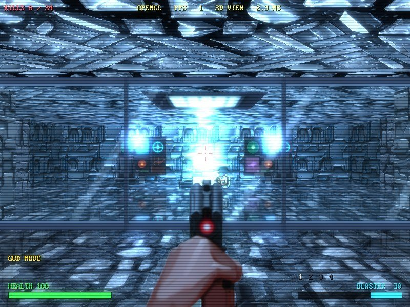
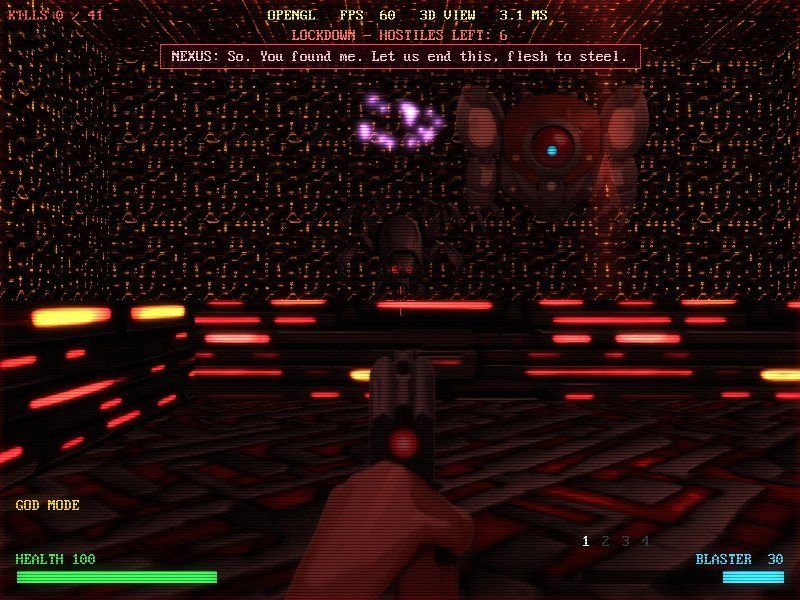
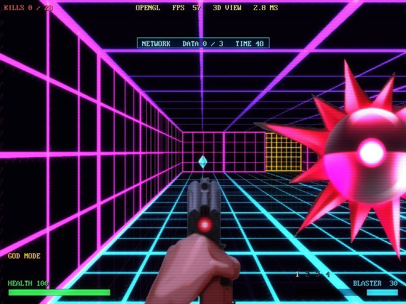
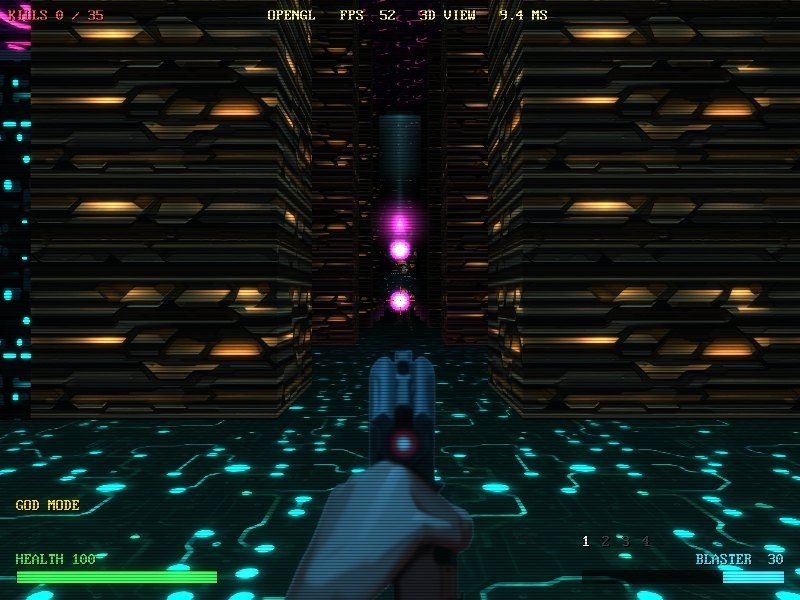
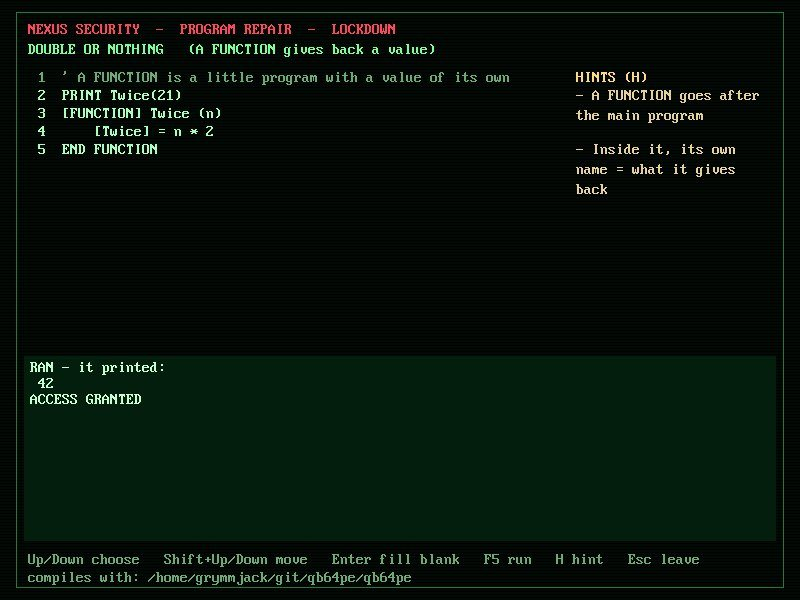
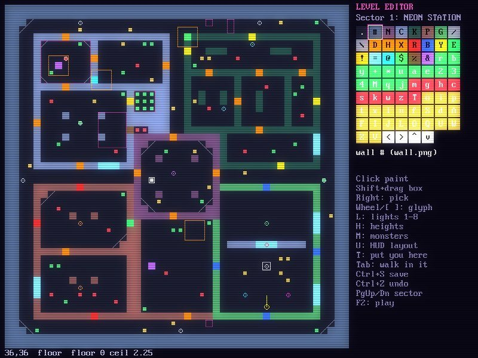

# NEON-CASTER

A first-person shooter in one file of QB64 Phoenix Edition BASIC, and a
course in how it's made. Ten sectors of a neon space station, ten kinds of
monster, four guns and a kick, glass you can shoot through, floors and
ceilings at every height, lifts and bottomless pits, teleporters, data
stations that turn the level into a wireframe network, code terminals that
lock you in until you fix a real QB64 program, and a villain who talks to
you. With a level editor, a monster editor and a HUD editor built in.

It draws its 3D two ways: a software raycaster, like Wolfenstein 3D, and an
OpenGL renderer with bump mapping, moving lights, wet floors, bloom and CRT
effects. Every picture comes in pixel art or a high-resolution painting
(ART in the video settings).

| | |
|---|---|
|  |  |
|  |  |
|  |  |

## Play it

Download it for your computer from the
[releases page](https://github.com/grymmjack/neon-caster/releases), unzip
it, and run the program inside. Keep it next to its `neon-caster` folder:
that's all the pictures, sounds, music and levels.

| | Download | Run |
|---|---|---|
| Windows 10/11 | `neon-caster-windows-x64.zip` | `neon-caster.exe` |
| Mac, Apple silicon (M1 and later) | `neon-caster-macos-arm64.zip` | `neon-caster-mac` |
| Linux, x86-64 | `neon-caster-linux-x64.tar.gz` | `neon-caster.run` |

**On a Mac:** the program isn't signed, so macOS stops it the first time.
Right-click it and choose **Open**, or run
`xattr -dr com.apple.quarantine neon-caster` on the unzipped folder.

**Controls:** mouse to look, W A S D to move, Shift to run, click to fire,
right button to aim, Space to open and use things, F to kick, 1-4 for guns,
Tab for the map, Esc for the menu and settings, ` for the console, F2 for
the level editor. The full list is in the tutorial.

## Learn from it

The source, [`neon-caster.bas`](neon-caster.bas), is written to be read:
its comments are a course in 24 chapters, from opening a window to casting
rays and handing the 3D to the graphics card with shaders.
[`neon-caster/TUTORIAL.md`](neon-caster/TUTORIAL.md) is the map for it,
with dozens of things to try.

## Build it yourself

1. Install [QB64 Phoenix Edition](https://qb64phoenix.com) 4.7 or newer.
2. Compile: `qb64pe -x neon-caster.bas -o neon-caster.run` (on Windows,
   `-o neon-caster.exe`; on a Mac, `-o neon-caster-mac`). Don't call the
   program just `neon-caster`: that's the name of its folder.
3. Run it from this folder.

The OpenGL shaders come from the GLSL library in
[QB64_GJ_LIB](https://github.com/grymmjack/QB64_GJ_LIB); a copy is in
[`lib/glsl/`](lib/glsl).

Releases are built by GitHub Actions
([`.github/workflows/build-release.yml`](.github/workflows/build-release.yml))
on Windows, macOS and Linux whenever a `v*.*.*` tag is pushed, with QB64-PE
built from a pinned commit.

## How it was made

Written by grymmjack with Claude. The modern art was painted with
pixelmon (Stable Diffusion XL, guided by the pixel art); the sound effects
and music were synthesized; NEXUS's voice is text-to-speech through a
vocoder.

MIT licensed - see [LICENSE](LICENSE). The GLSL library in `lib/glsl` is
MIT licensed too.
