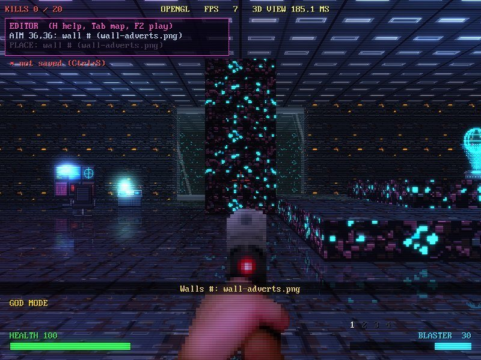
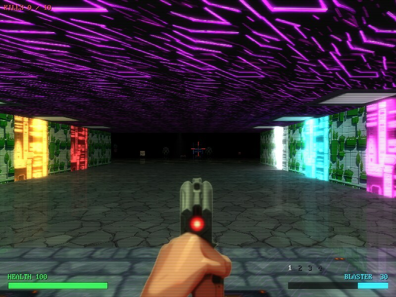

# NEON-CASTER

A first-person shooter in QB64 Phoenix Edition BASIC, and a course in
how it's made. Forty sectors of a neon space station in four
sets of ten - the originals, ten NEW SECTORS, OLD SECTORS NEW (the
first ten remade) and ten HUGE SECTORS, up to 192 cells across - twenty kinds of monster (turrets with seven weapons among them, and eyebots that zap you, then rush you and blow up), five guns, each with its own ammo - a rocket launcher the fifth - and a kick, glass you can shoot through, floors and
ceilings at every height, lifts and bottomless pits, open skies, teleporters, data
stations that turn the level into a wireframe network, code terminals that
lock you in until you fix a real QB64 program, DOOM-style secrets in
every sector (walls that slide away, switches you shoot, closets that hide
stashes), slot machines that pay out, blow up or let monsters out, NEON PONG on the
computers, a night vision headset, service droids going about their
business, spawners you can see charging, and a villain who talks to you - NEXUS greets you in every sector, and the monsters have voices of their own. Every sector has its own music. With a level editor built in - point and click inside the level in 3D
or on the map from above, with a picker of every wall, floor, door, item,
monster and light - and a monster editor and a HUD editor. Twelve more
sectors built with the editor come with it, three of them outdoors, and
one, THE NEON EXPO, that shows off every feature at once - and THE MONOLITH,
256 cells across and 30 walls high, as big as a sector gets - and THE STOCKPILE, THE COMPOUND and THE LAUNCH BAY, built to show off the newest of what follows. Jumping, rocket jumps, a jetpack, flying
drones, barrels of poison, lava and acid that leak and burst (stacked up to eight high),
treasure chests - and mimics that only look like them - ambushes of turrets that slide out of walls, floors and ceilings,
stronghold doors to kick down, keypad doors and safes whose codes are on notes you find, desks and
bookshelves to search, broken computers to fix and hack, security cameras to watch through, robot
guard dogs and guards who run to raise the alarm, a rocket camera (hold the middle button as you fire), jump pads that
shoot you across a sector (some set from a launch control, by sums you work out), a sector's own gravity, floors
as wet or dry as a level says, a harder network (hunters, sentinels, tracers and black ICE, firewalls, and a TRACE that climbs while ICE sees you - full, and more hunters come), a map
textured from above like Duke3D's, and a
console you can script (aliases, and an autoexec.cfg run at start-up). And 50
achievements, each with its own badge, ready for Steam, with each
sector's best times kept as records - and DOOM-style demos: record a
sector as you play it and play it back, exactly, frame by frame, on any
computer. Leave the title screen alone and an autopilot's demos play.

It draws its 3D two ways: a software raycaster, like Wolfenstein 3D, and an
OpenGL renderer with bump mapping, moving lights, wet floors, bloom and CRT
effects. Every picture comes in pixel art or a high-resolution painting
(ART in the video settings).

| | |
|---|---|
|  |  |
|  |  |
|  |  |
|  |  |

## Play it

Download it for your computer from the
[releases page](https://github.com/grymmjack/neon-caster/releases), unzip
it, and run the program inside. Keep it next to its `neon-caster` folder:
that's all the pictures, sounds, music and levels.

| | Download | Run |
|---|---|---|
| Windows 10/11 | `neon-caster-windows-x64.zip` | `neon-caster.exe` |
| Mac, Apple silicon (M1 and later) | `neon-caster-macos-arm64.zip` | `neon-caster-mac` |
| Linux, x86-64 | `neon-caster-linux-x64.tar.gz` | `neon-caster.run` |

**On a Mac:** the program isn't signed, so macOS stops it the first time.
Right-click it and choose **Open**, or run
`xattr -dr com.apple.quarantine neon-caster` on the unzipped folder.

**Controls:** mouse to look, W A S D to move, Shift to run, click to fire,
right button to aim, Space to open and use things, F to kick, 1-5 for guns,
Tab for the map, Esc for the menu and settings, ` for the console, F2 for
the level editor, F3 for where you are in numbers. The full list is in the tutorial.

**The programming puzzles need QB64PE.** A code terminal locks you in
until you fix a little QB64 program, and to really compile and run your
fix the game needs [QB64 Phoenix Edition](https://qb64phoenix.com)
installed:

1. Install QB64PE 4.7 or newer.
2. In the game, open **SETTINGS > QB64PE COMPILER** and point it at your
   `qb64pe` (type its path or its folder, or BROWSE for it). The screen
   says **COMPILING WITH YOURS** when it's found. In the console,
   `qb64pe /path/to/qb64pe` does the same.

The game looks for it by itself too (`$QB64PE`, your `PATH` and the usual
folders), so you may find it's already set. Without QB64PE the terminals
still let you through, but they only check your lines against the answer:
nothing is compiled or run.

**Three sets of ten:** **GAME > NEW GAME** (or SELECT SECTOR) plays the
original ten. **GAME > NEW SECTORS** is ten more, built on everything the
game has grown since: blocks inside cells (slim lit pillars, thin walls,
alcoves with terminals glowing in them), water, slime, poison, acid and
lava, loot in the breakables, lockdowns that slam shut, rooftops under a
storm, and the overseer at the end. **GAME > OLD SECTORS NEW** is the
first ten again, remade with all of that - same maps and routes, new
detail. **GAME > HUGE SECTORS** is ten big ones, 112 to 192 cells across:
districts of every kind - plazas under the sky, office floors, flooded
halls, reactors, server farms, gardens, turret towers with lifts, arenas
that lock round you while the turrets come out of the walls - three
keycards on the way to each exit, and a field boss waiting at the end of
the later ones. Each set runs 1 to 10 on its own, and a save remembers which set
it's from.

**Make your own:** **GAME > YOUR SECTORS > NEW SECTOR** gives you a
blank sector (one room in solid wall) and opens the level editor on it.
Push walls back, sink pits, stand blocks in cells (pillars, thin walls,
alcoves), flood floors with liquids, add doors, monsters and lights, paint
any picture on any face, set up ambushes, and Ctrl+S saves it to
`neon-caster/levels/custom/`. The [level editor guide](LEVEL-EDITOR-GUIDE.md)
explains every tool, key, map character and level-file field, and YOUR
SECTORS starts with twelve example sectors (three of them outdoors, under skies) built with the editor to take
apart.

**Achievements and records:** 50 achievements, from finishing sector 1 to
a thousand kills, a sector without a scratch, or kicking a machine into a
bottomless pit, each with its own badge. **GAME > ACHIEVEMENTS** shows
them all and how close you are, its RECORDS page has your best time,
kills and items for every sector, and STATS gives you a rank and your
lifetime totals. **SETTINGS > GAMEPLAY > SECTOR TIMER** puts the clock on
screen, green while you're inside your best time and red once past it. They're Steam achievements, through the
STEAM library in QB64_GJ_LIB. Until the game is on Steam they're kept in
`neon-caster/saves/achievements.txt`, and the game shows its own pop-up.
`steam/README.md` says what's needed to go live. Cheats (god mode,
`give`, the editor) hold them until your next new game.

**Demos:** press Ctrl+R and the sector starts again, recorded as you play
it - every key and turn, frame by frame, not a video - till Ctrl+R again
or the exit. **DEMO REPLAYS** in the main menu plays it back exactly: the
same monsters, shots and loot. (In the console: `record NAME`, `playdemo
NAME`.) `bot` hands the controls to an autopilot that plays like
someone new to the sector - exploring, fighting what it notices, missing
now and then - so it can make demos on its own: `playdemo sector1` to
`sector10` watch it play the original ten, to the exit or till it dies.
Leave the title screen alone for 15 seconds and they play by themselves.
Every sector also has a few service droids going about their business.
See `neon-caster/TUTORIAL.md`.

**Quick looks:** **SETTINGS > MODE** sets every video and effects setting
at once. OLDSCHOOL is chunky pixels with no effects, 90S is 720P with
scanlines and most effects, and NEWSCHOOL is as sharp as your display goes
with everything on. All three are full screen 4:3. Change any setting
afterwards and MODE shows CUSTOM.

**Sound:** **SETTINGS > AUDIO > SOUND TEST** (or `soundtest` in the
console) plays every sound effect, voice and track, by category, with a
player over the list: what's playing, how long it is and how far in, a seek
bar drawn as its waveform (click or drag to play from anywhere; P pauses,
[ and ] skip 5 seconds), a spectrum and scope moving with it, and AUTO (C) to
play the next when one ends. SOFTEN
HIGHS (OFF, LIGHT, STRONG) takes the edge off the sound effects and voices
if they're too bright on your speakers or headphones; the music is left as it is.

## Learn from it

The source is written to be read: its comments are a course in 24
chapters, from opening a window to casting rays and handing the 3D to the
graphics card with shaders. Start at [`neon-caster.bas`](neon-caster.bas):
it has the introduction and the game loop, and it includes the rest -
laid out like [DRAW](https://github.com/grymmjack/DRAW), a folder for each
part (`CORE/`, `WORLD/`, `GAME/`, `LEVEL/`, `RENDER/`, `GL/`, `MENU/`,
`EDITOR/`, `AUDIO/`, `DEMO/`, `ACH/`, and the game loop's chapters in
`LOOP/`), each module a `.BI` of declarations and a `.BM` of routines.
[`neon-caster/TUTORIAL.md`](neon-caster/TUTORIAL.md) is the map for it,
with dozens of things to try.

## How it was built

[`docs/`](docs) has two illustrated write-ups made during development: a
[showcase](docs/showcase/index.html) of every system with real frames from
the game, animations, sounds and performance heat maps, and the earlier
[roadmap run](docs/roadmap-run/index.html) report.

## Build it yourself

1. Install [QB64 Phoenix Edition](https://qb64phoenix.com) 4.7 or newer.
2. Compile: `qb64pe -x neon-caster.bas -o neon-caster.run` (it includes
   the folders beside it; on Windows,
   `-o neon-caster.exe`; on a Mac, `-o neon-caster-mac`). Don't call the
   program just `neon-caster`: that's the name of its folder.
3. Run it from this folder.

The OpenGL shaders come from the GLSL library in
[QB64_GJ_LIB](https://github.com/grymmjack/QB64_GJ_LIB); a copy is in
[`lib/glsl/`](lib/glsl).

Releases are built by GitHub Actions
([`.github/workflows/build-release.yml`](.github/workflows/build-release.yml))
on Windows, macOS and Linux whenever a `v*.*.*` tag is pushed, with QB64-PE
built from a pinned commit.

## How it was made

Written by grymmjack with Claude. The modern art was painted with
pixelmon (Stable Diffusion XL, guided by the pixel art); the sound effects
and music were synthesized (with soundmon); NEXUS's and the monsters' voices are
text-to-speech through a vocoder.

The footsteps and your cries when hurt (`neon-caster/sfx/step1.wav`,
`step2.wav`, `hurt.wav`, `hurt2.wav` and `hurt3.wav`) are from Imphenzia's Universal
Sound FX pack, used under its licence, and are not covered by the MIT
licence.

MIT licensed - see [LICENSE](LICENSE). The GLSL library in `lib/glsl` is
MIT licensed too.
